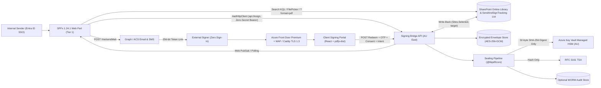
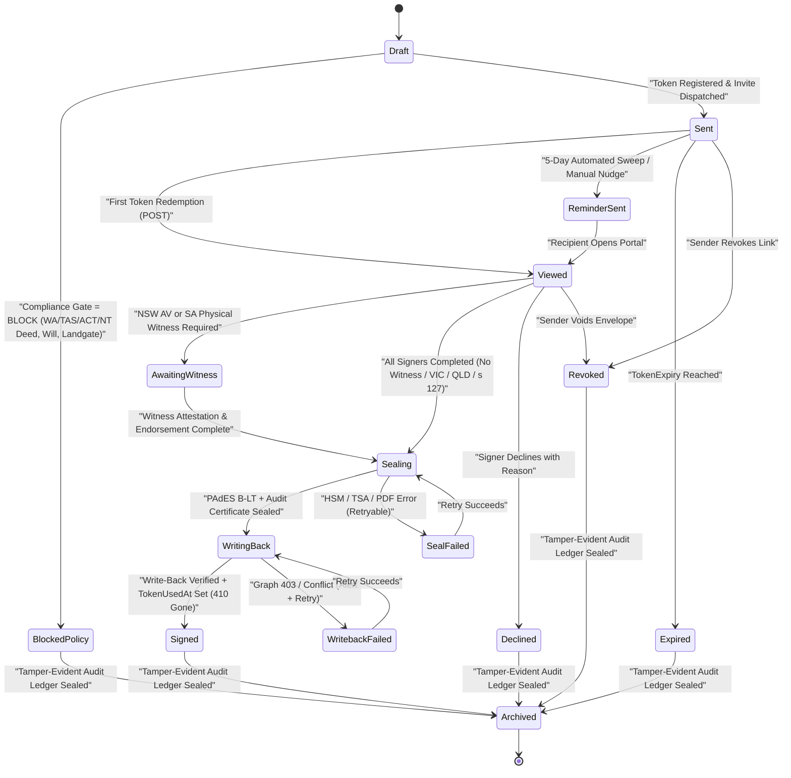

# Send & Sign — Master Project Guide, Architecture & Compliance Tracker

> **Document Purpose:** Living engineering specification, Australian compliance matrix, feature/tech blueprint, and progress/change tracker for the **SharePoint Native Send & Sign Application**. Synthesised from [The optimal architecture.docx](file:///c:/Antigravity/sendandsign/The%20optimal%20architecture.docx), [claude build.md](file:///c:/Antigravity/sendandsign/claude%20build.md), and [gemini build.docx](file:///c:/Antigravity/sendandsign/gemini%20build.docx) (Baseline: November 2026).
>
> **Not Legal Advice:** Items marked `⚖️` summarise Australian legislation and legal commentary as at November 2026 to inform product engineering. Qualified Australian legal counsel must confirm all statutory guardrails, consent wording, and policy matrix entries before commercial go-live.

---

## 1. Executive Summary & Architectural Philosophy

**Send & Sign** fuses the zero-sign-in, SharePoint-native operational model of the **Gemini Build** with the strict Australian statutory guardrails, PAdES B-LT HSM cryptography, and OWASP ASVS 5.0 security posture of the **Claude Build**.

### Core Design Pillars

1. **Zero-Sign-In External Experience:** External signatories open a single-use cryptographic link (`https://sign.<your-domain>/?token=<SigningToken>` or POST-redeemed session) in a standalone portal without provisioning Microsoft Entra B2B guest accounts or navigating Microsoft 365 login screens.
2. **Zero-Cost SharePoint-Native State Layer:** Workflow state, hashed single-use token pointers, document provenance, and canonicalized audit trails live natively inside the customer's Microsoft 365 tenant via the `SendAndSignTracking` and `SendAndSignSettings` SharePoint lists—eliminating external database sprawl for core tenant tracking (with optional WORM Blob archiving for enterprise/regulated tiers).
3. **Encrypted, Time-Limited Bridge Storage & APP 8 Sovereignty:** The Signing Bridge is designed to run exclusively in Australian Azure regions (**Australia East / Sydney** primary, **Australia Southeast / Melbourne** disaster recovery). It keeps each envelope only for the signing window plus a fixed retention period, AES-256-GCM encrypted at rest ([ADR-0002](docs/adr/0002-encrypted-durable-bridge-store.md) replaced the original zero-disk-persistence design); only a non-reversible 32-byte SHA-256 digest is ever sent to Azure Key Vault Managed HSM or an RFC 3161 Time Stamping Authority (TSA).
4. **Australian Statutory & Case Law Defensibility (v1 Scope: Simple Contracts):** Built-in validation enforces *Electronic Transactions Act 1999 (Cth)* s 10 (identity, intention, reliability, consent) across all Australian jurisdictions for simple commercial contracts, *Williams Group Australia Pty Ltd v Crocker [2016] NSWCA 265* (recipient-tethered sessions), and `@libpdf/core` incremental PDF updates. *(Non-simple-contract workflows—Deeds, *Corporations Act* s 127, and NSW/SA witnessing—were removed from the v1 codebase and deferred.)*
5. **Same-Folder Isolated Write-Back:** Signed PDFs (`{OriginalName}_Signed.pdf`) and separate/embedded Certificates of Completion are written back exclusively to the originating `OriginFolderPath`, leaving the original file untouched. *Target:* the bridge via Entra App-Only Managed Identity with least-privilege `Sites.Selected` / `Lists.SelectedOperations.Selected`. *Current:* the SPFx web part writes the copy under the signed-in user's own SharePoint permissions when the dashboard syncs (see §1.1).
6. **Tamper-Evident Audit Archiving & Clean Dashboard Lifecycle (Administrator-Only Central Source of Truth):** SharePoint Administrators (`isCurrentUserAdmin()`) can archive completed and closed records (`Signed`, `Declined`, `Revoked`, `Expired`, `BlockedPolicy`) into a designated **Central SharePoint Archive Folder** (Site → Document Library → Folder), generating a SHA-256 sealed JSON Audit Ledger (`SendAndSign_AuditArchive_YYYY-MM-DD_<hash8>.json`), moving historical rows into the `Archived` tab, and browsing/navigating to all historical backups via the **View Archive Backups** drawer.

### Product Packaging & Tier Strategy

| Package Tier | Target Scope & Included Capabilities | Status |
|---|---|---|
| **v1 Release** *(Core PDF Signing)* | **Simple Contracts (*ETA 1999 (Cth) s 10*) only**, Single & Multi-Signature (`Parallel` / `Sequential` routing up to 20 recipients), per-recipient 6-digit email OTP verification, interactive click-to-place signature positioning on PDF (`pdfjs-dist` + `@libpdf/core`), Draw/Type/Upload signatures, A4 Certificate of Electronic Signature, all-party completion email download links (`downloadToken`), KPI dashboard with quiet 30s refresh, manual reminders with fresh per-recipient links, and Tamper-Evident Audit Ledger Archiving. | **Active & Live (`v1.0.36` / `1.1.0.1`)** |
| **v2.0 Release** *(Claude Connector & Interactive HTML Proposals)* | Everything in v1 plus **Interactive HTML Proposal Signing** (`data-ss-*` checkboxes, radio tiers, text inputs, deterministic server-side AUD pricing & GST calculation), strict zero-script HTML/CSS sanitization (`htmlSanitizer.ts`) + sandboxed `<iframe sandbox="">` rendering (`HtmlProposalViewer.tsx`), self-contained `{OriginalName}_Signed.html` write-back with embedded RFC 8785 Evidence Pack & one-click **Verify HTML Integrity** in SPFx, **Claude MCP Connector** (`packages/mcp-connector` stdio + remote `/mcp` JSON-RPC 2.0 + RFC 9728 OAuth 2.0 Protected Resource Metadata for multi-user Microsoft 365 login), **Connect to Claude** setup modal (`ConnectClaudeModal.tsx`), and encrypted **Claude Drafts** inbox (`My Drafts` / `All Team Drafts`). | **Implemented & Packaged (`v2.0.0.0`)** |
| **v2.x / Enterprise Roadmap** *(Planned)* | Optional Azure Key Vault Managed HSM PAdES B-LT hardware sealing + RFC 3161 TSA, bridge app-only `Sites.Selected` write-back, automated 5-day reminder dispatch, and Azure Web PubSub push notifications. *(Deed/Witness/s 127 workflows are out of scope and removed from the codebase.)* | **Planned** |

### 1.1 Implementation Status at a Glance (as of 2026-11-20)

Sections 2–8 of this guide specify the **target** architecture. Where the running code differs, this table is authoritative; do not describe a target capability as live in customer-facing material until it moves to the right-hand column.

| Area | Target (specified in this guide) | Current implementation |
|---|---|---|
| **Bridge hosting** | Azure Container Apps, Australia East / Southeast (`deploy/bicep/main.bicep`) | Single Docker host on a Hostinger KVM VPS ([vps-deployment-guide.md](docs/vps-deployment-guide.md)), with `25 MiB` Fastify JSON `bodyLimit` (supporting PDFs up to ~18 MB). **The VPS region must be confirmed as Australian before any APP 8 claim.** Pure-Node v2 HTML sealing requires zero Chromium/Playwright overhead. |
| **Bridge state** | SharePoint-native state + transient in-memory PDFs | AES-256-GCM encrypted SQLite on the `bridge_data` volume (`sqliteStore.ts`, [ADR-0002](docs/adr/0002-encrypted-durable-bridge-store.md)), storing both `envelopes` and staged Claude `html_drafts`; finished envelopes purged after `BRIDGE_RETENTION_DAYS` (default 90). Single bridge instance only. |
| **SPFx → bridge auth** | Entra `api://esign` delegated token, tenant allow-list | **Implemented & Live Multi-Tenant** (`auth.ts`): `esign-api` configured as Multitenant (`Any Entra ID Tenant`) with Web Redirect URI (`https://sign.sendandsign.online`), one-click Global Admin `/organizations/adminconsent`, RS256 JWKS verification, `aud`, `iss`↔`tid`, `scp=Envelope.ReadWrite`, and `ALLOWED_TENANT_IDS` gate. **First external customer tenant onboarded and verified live end-to-end.** Runbooks in [entra-esign-api-setup-guide.md](docs/entra-esign-api-setup-guide.md) & [register_tenant.md](docs/register_tenant.md). |
| **Signing tokens** | 256-bit, hashed at rest | **Implemented**: SharePoint stores only `BridgeEnvelopeId` + `SigningTokenSha256`; bridge stores hashes only; reminders rotate tokens. |
| **Cryptographic sealing** | PAdES B-LT: CMS in `/ByteRange` via Managed HSM + RFC 3161 TSA | **PDF:** Visual stamps + A4 Audit Certificate page (`SignedSha256` + RFC 8785 hash-chained audit trail; no PAdES/HSM signature yet—FR-13 open). **HTML (`v2.0`):** Self-contained `{OriginalName}_Signed.html` with locked interactive selections, visual signature cards, printable Certificate of Electronic Signature, `#sendandsign-sealed-body` SHA-256 digest, and embedded `#sendandsign-evidence-pack` verified on-demand in SPFx (`Verify HTML Integrity`). |
| **Write-back** | Bridge app-only `Sites.Selected` (`writeback.ts`) | SPFx `syncEnvelopesFromBridge()` writes `{OriginalName}_Signed.pdf` or `{OriginalName}_Signed.html` with the signed-in user's own SharePoint permissions when the dashboard syncs. **Fails closed:** validates `%PDF-` or sealed HTML markers, verifies whole-file `SignedSha256` against the bridge, and enforces origin-site containment (`assertSafeWriteBackTarget`); otherwise marks `WritebackFailed` (*Save Failed*) and retries on next sync. `writeback.ts` is built and unit-tested but not wired in. |
| **Interactive HTML Proposals (`v2.0`)** | Client-selectable options + deterministic pricing + zero-script sandbox | **Implemented (`v2.0.0`):** `packages/domain/src/htmlProposal.ts` + `signing-bridge/src/htmlSanitizer.ts` + `htmlSealer.ts` + `signing-portal/src/HtmlProposalViewer.tsx`. Supports SharePoint `.html` files, pasted HTML, and Claude Drafts; strips all `<script>` / event handlers / `javascript:` URLs; recomputes `basePriceCents`, add-ons, GST, and total server-side; verified end-to-end in SharePoint. |
| **Claude MCP Connector (`v2.0`)** | Local `stdio` + Remote HTTP MCP with per-user M365 Entra OAuth | **Implemented (`v2.0.0`):** `packages/mcp-connector` (`stdio` CLI + `.mcp.json`) and remote `POST /mcp` on `signing-bridge` with 4 tools (`get_proposal_design_spec`, `validate_html_proposal`, `create_html_proposal_draft`, `list_html_proposal_drafts`), RFC 9728 OAuth 2.0 Protected Resource Metadata (`/.well-known/oauth-protected-resource`), CORS for `https://claude.ai`, SPFx **Connect to Claude** modal (`ConnectClaudeModal.tsx`), and per-user `My Drafts / All Team Drafts` inbox. |
| **Signer OTP** | T1 Email (default) + T2 SMS via ACS | Email OTP via SMTP only. A `T2` envelope is also sent by email; the SPFx sends no tier, so all envelopes use T1. Since `v1.0.35` the bridge only releases the document (`/api/envelope/pdf`, `/api/envelope/html`) and evidence pack after OTP verification (T0 excepted); decline still works without OTP. |
| **Reminders & expiry** | Automated 5-day + manual reminders, expiry sweep | Manual reminders (bridge `reissue` → fresh per-recipient links). Hourly expiry sweep + retention purge. **Automated 5-day reminder e-mails are not wired.** |
| **Real-time updates** | Azure Web PubSub + 30s polling fallback | 30-second polling only. |
| **Fail-closed sealing & signer identity** | `SealFailed` / `WritebackFailed` states; signer bound to recipient record | **Implemented (`v1.0.34`).** A failed stamp/seal consumes nothing, records a hash-chained `SealFailed` event (envelope state `SealFailed` for the final seal, mirrored to SharePoint), and returns 503 so the signer can retry. The signer's identity in the audit trail, certificate and SharePoint `SignerName`/`SignerEmail` is the token-bound, OTP-verified recipient record; a different typed name is recorded only as `AdoptedName`, and a client-supplied e-mail is ignored. |
| **Compliance scope** | Simple Contract compliance (*ETA 1999 (Cth) s 10*) + multi-signature | **Simple Contract only (`v1` & `v2.0`):** All Deed, *Corporations Act* s 127, Will/Landgate, `BlockedPolicy`, `AwaitingWitness`, and NSW/SA witness code has been removed from `packages/domain`, `packages/audit`, `signing-bridge`, `signing-portal`, and `spfx-send-and-sign`. |

---

## 2. Two-Tier Decoupled Reference Architecture

### 2.1 System Component Map (C1–C10)

| ID | Tier / Component | Technology Stack | Core Responsibility |
|---|---|---|---|
| **C1** | **Tier 1: Internal SPFx Web Part** (`spfx-send-and-sign`) | SPFx `1.24.1`, React `18.3.1` (`--save-exact`), TypeScript `5.8`, Heft build rig, Node `24`/`26` LTS, Fluent UI v9, PnPjs v4, PnP `FilePicker` | Runs under internal user's Entra ID SSO. Tenant-wide site/folder/PDF & Office file discovery (Search KQL + Graph fallbacks), Office-to-PDF conversion via Graph (`?format=pdf`), `OriginalSha256` calculation, Australian Statutory Compliance & Deed-Detection Wizard, zero-secret token registration (`POST /api/tokens/register`), invitation dispatch (`/me/sendMail` or ACS), and live status dashboard. |
| **C2** | **Tier 2A: Zero-Sign-In Client Portal** (`signing-portal/`) | Standalone React `18` + Vite SPA behind Azure Front Door Premium + WAF / Caddy (TLS 1.3) | Anonymous, token-gated external signer UI. Redeems token via `POST` into `HttpOnly; Secure; SameSite=Strict` session, enforces tiered OTP step-up (Email/SMS), displays APP 5 notice & versioned ETA consent (with paper opt-out), renders 3-layer PDF via `pdfjs-dist`, normalizes spatial coordinates, captures draw/type/upload signatures & NSW/SA witness attestations, and submits explicit signing intent. |
| **C3** | **Tier 2B: Signing Bridge & API** (`signing-bridge/`) | Node.js `24` LTS + TypeScript (Fastify) on Azure Container Apps (AU East / AU Southeast); currently a single Docker host (§1.1) | Validates 256-bit single-use tokens (SHA-256 hashed, per-envelope lock, HTTP `410 Gone` on replay), validates Entra access tokens from SPFx (`api://esign`, `Envelope.ReadWrite`), holds envelopes in the AES-256-GCM encrypted `EnvelopeStore` for the signing window + retention (ADR-0002), orchestrates stamping, sealing, and write-back. |
| **C4** | **Cryptographic Sealing Engine** (Isolated Worker / Module) | `@libpdf/core` (MIT) + `node-forge` + Azure Key Vault Managed HSM (`RS256`/`PS256`) + RFC 3161 TSA | Visual signature & witness block stamping, A4 Certificate of Electronic Signature & Audit Trail generation, PDF Incremental Updates (`/Type /Sig`, `/ByteRange`), detached PKCS#7 (CMS) packaging, RFC 3161 timestamping, and OCSP/CRL embedding (**PAdES B-T / B-LT**). |
| **C5** | **Zero-Cost SharePoint-Native State Store** | SharePoint Custom Lists: `SendAndSignTracking` & `SendAndSignSettings` | Stores envelope lifecycle state, recipient metadata, `OriginalSha256`, `SignedSha256`, origin pointers (`OriginSiteUrl`, `OriginLibraryId`, `OriginFolderPath`, `OriginFileUniqueId`), `BridgeEnvelopeId`, `SigningTokenSha256` (never the raw token), `TokenExpiry`, `TokenUsedAt`, compliance policy outputs, and RFC 8785 (JCS) hash-chained `AuditLogJson`. |
| **C6** | **Encrypted Envelope Store & Optional WORM Evidence Store** | AES-256-GCM encrypted SQLite (`sqliteStore.ts`, ADR-0002) + optional Private Azure Blob Storage (CMK in Managed HSM, Immutable WORM policy) | Encrypted, retention-purged storage of in-flight envelopes (PDFs, state, hashed tokens/sessions); optional immutable WORM audit/evidence archive (7–25 years) and daily TSA-anchored chain heads for regulated enterprise/government buyers. |
| **C7** | **Write-Back & SharePoint Provisioning Worker** | Entra App-Only (`esign-worker`) with Managed Identity + `Sites.Selected` / `Lists.SelectedOperations.Selected` | Enforces strict hostname and `OriginFolderPath` isolation checks before uploading `{OriginalName}_Signed.pdf` (or optional Major Version `CheckOut`/`CheckIn` overwrite), applying SharePoint retention labels, and updating `Status = Signed`. |
| **C8** | **Messaging & Reminder Orchestrator** | Graph `POST /me/sendMail` + Azure Communication Services (ACS Email & AU-number SMS) + Cron/Durable Sweep (`reminders.ts`) | Dispatches "Sign Now" invites, 6-digit OTP challenges, automated 5-day reminders, manual dashboard nudges (`sendReminderNudge`), expiration sweeps, decline/revoke notices, and sender completion alerts. |
| **C9** | **Real-Time Notification Hub** | Azure Web PubSub + 30-second polling fallback (+ optional Teams Activity Feed) | Pushes live `Viewed`, `Declined`, and `Signed` toast notifications to the SPFx web part dashboard within 60 s (p95). |
| **C10** | **SecOps & Telemetry** | App Insights, Log Analytics (Australia East), Microsoft Sentinel, Microsoft Defender for Cloud | Monitors OTP brute-force spikes, multi-country token redemption anomalies, seal failures, write-back `403`s, and admin changes with PII/token log redaction. |

### 2.2 End-to-End Architecture Flow



### 2.3 Envelope Lifecycle State Machine

Every state transition is idempotent, validated by the domain state machine, and appends a canonicalized RFC 8785 (JCS) hash-chained event to `AuditLogJson`. **Target:** the pipeline fails closed: an envelope cannot transition to `Signed` (`COMPLETED`) unless both the PAdES cryptographic seal and the SharePoint write-back upload succeed. *(Current: the bridge marks `Signed` after stamping + certificate and records `SealFailed` when that fails; write-back happens later from SPFx, which records `WritebackFailed` and retries rather than marking a row `Signed` without a verified upload. See §1.1.)*



### 2.4 Four-Layer Internal Engine Architecture

1. **Layer 1 — Form & Document Engine:** Renders PDFs via `pdfjs-dist` across three stacked layers (Canvas, Text, Annotation), manages interactive field placement (signature, initials, text, checkbox, radio, date, witness statement), and converts CSS viewport coordinates to PDF user-space points (`convertToPdfPoint`).
2. **Layer 2 — Workflow & Routing Engine:** Governs single-party and multi-party (up to 20 recipients) sequential/parallel routing, company s 127 split/hybrid execution, automated 5-day reminder sweeps, manual sender nudges, revocation/voiding, and signer decline workflows.
3. **Layer 3 — Cryptographic & Hash Validation Engine:** Computes pre-signing `OriginalSha256`, canonicalizes audit metadata using **RFC 8785 (JCS)**, constructs PDF Incremental Updates via `@libpdf/core`, executes detached signing via Australian Azure Key Vault Managed HSM (`RS256`/`PS256`), embeds RFC 3161 timestamps and OCSP/CRL revocation data (**PAdES B-T / B-LT**), and enforces fail-closed post-signing integrity checks.
4. **Layer 4 — Audit Logging & Integration Layer:** Persists immutable event chains (`Sent`, `Viewed`, `OtpVerified`, `ConsentRecorded`, `IntentConfirmed`, `WitnessEndorsed`, `Signed`, `Declined`, `Revoked`, `WriteBackCompleted`) into `SendAndSignTracking.AuditLogJson` (and optional Blob WORM), renders the A4 Certificate of Electronic Signature & Audit Trail, and exposes REST endpoints, event webhooks (`document.signed`, `document.declined`), and optional MCP tool bindings.

### 2.5 SPFx-to-Bridge & Write-Back Security Pattern

1. **Two Entra App Registrations:**
   - `esign-api` (Delegated): Exposes `api://esign/Envelope.ReadWrite`, declared in `package-solution.json` under `webApiPermissionRequests`, approved once by a SharePoint Admin in **SharePoint Admin Center > Advanced > API access**.
   - `esign-worker` (App-Only): Uses Managed Identity federated credentials or certificate auth with **Sites.Selected** / **Lists.SelectedOperations.Selected** granted at site/library onboarding (`POST /sites/{id}/lists/{id}/permissions`).
2. **Shared Principal Isolation:** Because approved SPFx API scopes are held by the tenant-wide *SharePoint Online Client Extensibility Web Application Principal*, `spfx-send-and-sign` requests only `api://esign` (never broad tenant-wide Graph write scopes where avoidable in commercial multi-tenant mode), passes only `siteUrl`, `driveId`, `itemId`, and `eTag` (target; currently the SPFx sends the PDF bytes to the bridge over TLS at registration), and verifies `aud`, `iss`, `scp`, and `tid` against onboarded tenants on the Signing Bridge (implemented in `signing-bridge/src/auth.ts`). Consider `isDomainIsolated: true` for high-security deployments.

---

## 3. Technology Stack & Platform Constraints (November 2026 Baseline)

| Layer | Choice & Version | Mandatory Technical Constraints |
|---|---|---|
| **SPFx Platform** | `@microsoft/generator-sharepoint` `1.24.1` | Targets SharePoint Online exclusively. Pin all `@microsoft/sp-*` packages to `1.24.1` (maintenance release fixing 1.24.0 RC package refs). |
| **Node.js (SPFx & Bridge)** | Node.js `24` LTS (or `26` LTS / `22.14.0+`) | Pin SPFx `.nvmrc` separately because SPFx caps TypeScript at `5.8`. |
| **UI Framework (SPFx)** | `react@18.3.1` & `react-dom@18.3.1` (`--save-exact`) | Exact pin prevents silent runtime failures. Use `createRoot`/`root.unmount()`; `@types/react` `^18.3.0`. Fluent UI v9 / PnP SPFx controls (verify React 18 compatibility). |
| **TypeScript** | `5.8` (`strict`, `noUncheckedIndexedAccess`) | Preserve SPFx Heft rig `jsx: "react"` setting rather than automatic JSX transform. |
| **Build Toolchain** | `@rushstack/heft` + Webpack + SystemJS | Gulp is **not supported** in SPFx 1.24. Local debugging uses `https://localhost:4321/temp/build/manifests.js`. |
| **SharePoint Integration** | PnPjs v4, `@pnp/spfx-controls-react` (`FilePicker`), Graph REST | Combine Search KQL (`contentclass:STS_Site OR contentclass:STS_Web`, `fileextension:pdf`) + Graph fallbacks (`/sites?search=*`, `/me/followedSites`). Convert Office formats (`doc/docx/xlsx/pptx/rtf/odt`) via `GET .../items/{id}/content?format=pdf` (`.docm` rejected). |
| **Client PDF Viewer** | `pdfjs-dist` (Apache-2.0) | 3-layer rendering (Canvas + Text + Annotation) with `PageViewport.convertToPdfPoint` spatial normalization. |
| **PDF Stamping & PAdES** | `@libpdf/core` (MIT) + `node-forge` | Native TypeScript PDF Incremental Updates, brute-force XRef recovery for malformed corporate PDFs, PAdES B-B through B-LTA. **Zero AGPL/GPL/SSPL code allowed.** |
| **External Portal** | React `18` + Vite SPA + HTML5 Signature Pad | Deployed behind Azure Front Door Premium + WAF or Caddy (TLS 1.3). Zero Microsoft login, zero SharePoint OAuth tokens in browser. |
| **Cloud Compute & Storage** | Azure Container Apps (Australia East / Southeast), Private Azure Blob (optional WORM) | Azure Policy `allowed-locations` locked to Australian regions. Bridge persists in-flight envelopes only in its AES-256-GCM encrypted store (ADR-0002). |
| **HSM & Timestamping** | Azure Key Vault Managed HSM (FIPS 140-3 L3, Australia) + AATL CA + RFC 3161 TSA | Non-exportable signing key; yearly rotation and dual control. Only 32-byte SHA-256 digests leave the Australian boundary for TSA stamping. |
| **Messaging & Real-Time** | Graph `/me/sendMail`, ACS Email (AU data location), ACS SMS (AU mobile number), Azure Web PubSub | **Effective 1 July 2026:** Alphanumeric SMS Sender IDs to Australian numbers are blocked—must provision an ACS Australian mobile number. |
| **IaC & CI/CD** | Bicep (Azure Verified Modules), GitHub Actions (OIDC), CLI for Microsoft 365 (`m365 spo app deploy`) | Automated pipeline with `pnpm` monorepo support. |
| **Testing & Security Scans** | Jest (SPFx), Vitest, Playwright, `axe-core`, `k6`, CodeQL, OSV-Scanner, Trivy, Syft (CycloneDX SBOM), `cosign`, Gitleaks, OWASP ZAP | Block High/Critical CVEs; enforce WCAG 2.2 AA and EU DSS PAdES validation per build. |

### Non-Negotiable Platform Deprecations (2026)

- **Azure ACS & SharePoint Add-ins Retired (2 April 2026):** Permanently discontinued with no extension. All app-only SharePoint access must use Entra ID apps with Managed Identity or certificate credentials.
- **SharePoint Online CSP Enforcement (Live 1 March / 1 June 2026):** All scripts must bundle inside `.sppkg` or trusted `cdnBasePath`. Inline scripts and dynamic external `SPComponentLoader.loadScript` calls are blocked by SharePoint Online.
- **Least-Privilege Graph Scopes:** Never use `Files.ReadWrite.Selected` (Microsoft warns it should not be used for direct Graph API calls). Use `Sites.Selected` and `Lists.SelectedOperations.Selected`.

---

## 4. Cryptographic & PDF Sealing Pipeline Specification

To defeat *Bendigo and Adelaide Bank Limited v Pickard [2019] SASC 123* ("single static document" invalidation) and PDF Shadow Attacks (Hide / Replace / Hide-and-Replace), the Signing Bridge executes a strict 6-stage **target** pipeline (stages 4–5 are not yet implemented; see §1.1):

1. **Pre-Signing Digest (`OriginalSha256`):**
   - Upon document selection (or after Graph `?format=pdf` conversion for `.docx`/`.xlsx`/`.pptx`/`.rtf`/`.odt`), compute `OriginalSha256` via Web Crypto / Node `crypto` and store it in `SendAndSignTracking`.
2. **Spatial Coordinate Normalization (`pdfjs-dist`):**
   - Browser CSS pixels locate `(0, 0)` at top-left (Y downward); PDF user space uses points (`1 pt = 1/72 inch`) with `(0, 0)` at bottom-left (Y upward).
   - Convert every placed signature, initial, date, and witness box into zoom-independent PDF bounding boxes `[x1, y1, x2, y2]` using `PageViewport.convertToPdfPoint` / `convertToViewportRectangle`.
3. **Visual Stamping & A4 Certificate Generation (`@libpdf/core`):**
   - Stamp drawn/typed/uploaded signature imagery, signer name, UTC/local execution timestamp, and applicable statutory execution block (Templates A1–D) at normalized coordinates.
   - Append a dedicated **A4 Certificate of Electronic Signature & Audit Trail** embedding `OriginalSha256`, recipient identities, s 127 officer capacities, OTP verification event, consent version & hash, IP/User-Agent, witness endorsement (if applicable), and canonicalized event timeline.
4. **PDF Incremental Update & Shadow Attack Mitigation:**
   - Using `@libpdf/core`, append new PDF objects, an XRef table, and a Trailer without mutating existing file bytes (preserving any prior signatures in multi-party/split execution).
   - Inject a `/Type /Sig` dictionary with a hollow hex `/Contents` placeholder and a four-integer `/ByteRange [0, Length1, Start2, Length2]` covering the entire binary except the `/Contents` placeholder itself—leaving zero unreferenced objects susceptible to XRef manipulation.
5. **Decoupled HSM Signing & RFC 3161 TSA (PAdES B-T → B-LT):**
   - Canonicalize dynamic audit JSON via **RFC 8785 (JCS)** and compute the SHA-256 digest of the `/ByteRange` slices.
   - Send the Base64URL-encoded 32-byte digest to Australian **Azure Key Vault Managed HSM** (`/keys/{key-name}/sign?api-version=2025-07-01`) for `RS256` or `PS256` signing using an AATL-listed CA certificate.
   - Package the signature and X.509 certificate chain into a detached **PKCS#7 / CMS (`RFC 5652`)** container (`ETSI.CAdES.detached`).
   - Send a hash of the signature to an **RFC 3161 TSA** and embed the timestamp token plus OCSP/CRL revocation responses into the CMS unsigned attributes to satisfy **ETSI EN 319 142 PAdES B-LT**.
   - Inject the DER-encoded CMS hex into `/Contents` and compute `SignedSha256`.
6. **Isolated Same-Folder Write-Back:**
   - Verify target hostname and folder path match `OriginSiteUrl` and `OriginFolderPath` in `SendAndSignTracking`.
   - **Default Mode (Signed Copy):** Upload `{OriginalName}_Signed.pdf` (or `name (Signed YYYY-MM-DD).pdf` per tenant naming policy) into `OriginFolderPath` and optionally upload a standalone Certificate PDF; never alter the original file's `eTag`.
   - **Optional Mode (Versioned Overwrite):** Call `CheckOut()`, stream binary to `/$value`, and `CheckIn(checkintype=1)` to increment Major Version (`v1.0` → `v2.0`).
   - Atomically set `TokenUsedAt` (enforcing HTTP `410 Gone` on future replay), update `Status = Signed`, apply SharePoint retention label, and trigger completion notifications.

---

## 5. Australian Legal, Statutory & Compliance Matrix (Validated Nov 2026)

### 5.1 Federal Statutory Foundations & Case Law Defenses

| Authority / Precedent | Statutory / Legal Requirement | Technical Control in Send & Sign |
|---|---|---|
| **ETA 1999 (Cth) s 10** (and state ETAs) | Requires **Identity**, **Intention**, **Reliability**, and **Consent** for electronic signatures. | Single-use 256-bit token + OTP (Identity); explicit `"Sign and complete"` confirmation (Intention); `OriginalSha256` / `SignedSha256` + hash-chained audit trail + A4 certificate today, PAdES B-LT HSM seal + RFC 3161 TSA once FR-13 ships (Reliability; see §1.1); versioned consent checkbox with paper opt-out (Consent). |
| **Corporations Act 2001 (Cth) ss 110A, 126, 127, 129(5)** | Permanent electronic execution for companies, including **company deeds without witnesses** (`s 127(3A)`), no physical delivery (`s 127(3B)`), and split/hybrid counterparts (`s 110A(4)-(5)`). | Officer capacity selector (`2 Directors`, `Director + Secretary`, `Sole Director & Sole Secretary / No Secretary`) so `s 129(5)` due execution assumptions attach; optional ASIC officer verification prompt; supports split execution. |
| **Williams Group Australia Pty Ltd v Crocker [2016] NSWCA 265** | Prevents unauthorized staff/admin stamping ("ostensible authority" challenge). | Signing sessions are cryptographically tethered to the specific recipient's `ClientEmail` via 256-bit token + channel-separated OTP challenge. |
| **Bendigo and Adelaide Bank Ltd v Pickard [2019] SASC 123** | Invalidated deeds signed across detached counterparts rather than a single static document. | `@libpdf/core` PDF Incremental Updates append signatures & A4 Certificate to the single static PDF binary without altering original byte ranges. |

### 5.2 State-by-State Individual Deed Matrix (Validated November 2026)

> **Conflict of Laws Rule `⚖️`:** Where the document's governing law jurisdiction and the individual signer's physical place of signing differ, the policy engine enforces the **stricter** jurisdiction's rules.

| Jurisdiction | Individual Electronic Deed | Witness Required? | Remote AV Witnessing | Governing Law (Nov 2026) | Policy Engine Decision |
|---|---|---|---|---|---|
| **Cth (Companies s 127)** | **Yes** | **None** | N/A (optional s 127(2A) common seal) | *Corporations Act 2001 (Cth)* ss 110A, 127(3A) | `ALLOW` (Templates A1 / A2) |
| **Victoria (VIC)** | **Yes** | **Not required** (*PLA 1958* s 73) | Permitted if witness used | *Electronic Transactions (Victoria) Act 2000* s 12A (keep "expressed to be sealed" wording per s 73A) | `ALLOW` (Template B) |
| **Queensland (QLD)** | **Yes** | **Not required** (*PLA 2023* s 51(2)) | N/A (not needed for individual deeds) | *Property Law Act 2023 (Qld)* Pt 6 Div 1 (commenced 1 Aug 2025; general POAs excluded under s 47) | `ALLOW` (Template B) |
| **New South Wales (NSW)** | **Yes** | **Mandatory** (non-party, s 38(1)) | **Yes** (real-time AV link permanent under *ETA 2000 (NSW)* s 14G) | *Conveyancing Act 1919 (NSW)* s 38A; *ETA 2000 (NSW)* Pt 2B s 14G (requires statutory endorsement checkbox) | `ALLOW-WITH-WITNESS` (Template C) |
| **South Australia (SA)** | **Yes** (since 15 Jan 2026) | **Mandatory** (≥1 non-party witness, s 41(2)(a)) | **Physical presence required** (AV not expressly authorized `⚖️`) | *Law of Property Act 1936 (SA)* s 41 (substituted by Act 64 of 2025 from 15 Jan 2026) | `ALLOW-WITH-WITNESS + WARN` (Template D) |
| **Western Australia (WA)** | **No** | **Mandatory** (physical, non-party) | **No** | *Property Law Act 1969 (WA)* s 9; *ETA Regs 2012* reg 3(1). (*Electronic Mortgages Bill 2025* covers ADI mortgage counterparts only; assent pending) | **HARD `BLOCK`** → Wet-Ink Print Pack |
| **Tasmania (TAS)** | **No** | **Mandatory** (physical, non-party) | **No** | *Conveyancing and Law of Property Act 1884 (Tas)* s 63 | **HARD `BLOCK`** → Wet-Ink Print Pack |
| **ACT** | **No** | **Mandatory** (physical, non-party) | **No** (COVID rules expired 31 Dec 2022) | *Civil Law (Property) Act 2006 (ACT)* s 219 | **HARD `BLOCK`** → Wet-Ink Print Pack |
| **Northern Territory (NT)** | **No express provision** | Attestation required for deemed sealing | **No** | *Law of Property Act 2000 (NT)* s 47 (`⚖️` ETA NT applicability unverified) | **HARD `BLOCK`** → Wet-Ink Print Pack |

### 5.3 Document-Type Policy Decision Matrix

All policy rules live as data (`policy/` YAML & `SendAndSignSettings`) tagged with `legal_review_ref` so legislative updates require zero code redeploy.

| Document Category | Signer Type | App Decision | App Behaviour & Guardrails |
|---|---|---|---|
| **Simple Contracts** (NDA, MSA, SOW, Offer Letter) | Any | `ALLOW` | Standard signing flow, Tier 1 (Email OTP) default. |
| **s 127 Company Documents & Deeds** | Australian Company | `ALLOW` | Capture officer capacity (Template A1 / A2); support split/hybrid execution. |
| **Agent / Attorney for Company (s 126)** | Agent / Attorney | `WARN` | Require upload/reference of written board authority; flag NSW s 51A witnessing grey area `⚖️`. |
| **Deed by Individual** (Guarantee, Release, IP Assignment) | Individual | Jurisdiction-dependent | Automated deed-phrase detector (`"executed as a deed"`, `"signed, sealed and delivered"`, ≥95% recall) triggers jurisdiction gate; advises recasting as simple contract if valuable consideration exists. |
| **Trusts, Partnerships, Foreign Companies** | Varies | `WARN` | Display legal review prompt and require explicit sender acknowledgement. |
| **Wills, EPAs, Advance Health Directives, General POAs** | Individual | **HARD `BLOCK`** | Cannot send electronically; direct to wet-ink / statutory formal execution. |
| **Land-Registry Instruments** (Landgate, Transfers, Caveats) | Any | **HARD `BLOCK`** | Block dispatch; redirect user to PEXA / ELNO lodgment. |
| **Cth Statutory Declarations** | Individual | **HARD `BLOCK`** | Redirect to myGov / approved video-link platform (Send & Sign is not an approved Cth stat dec platform). |
| **State Stat Decs, Affidavits, Court Documents** | Individual | **HARD `BLOCK`** `⚖️` | Block electronic dispatch in SPFx modal. |
| **Consumer Credit & Insurance Disclosures** | Consumer | `WARN` `⚖️` | Surface sector-specific regulatory compliance check. |

### 5.4 Built-In Australian Execution Block Templates (A1–D)

| Template | Target Signatory & Jurisdiction | Statutory Header & Required Fields |
|---|---|---|
| **Template A1** | Multi-Director Company (`s 127(1)` Cth — All States) | **Header:** `EXECUTED as a DEED by [COMPANY NAME] PTY LTD (ACN [XXX XXX XXX]) in accordance with section 127(1) of the Corporations Act 2001 (Cth):`<br>**Fields:** Signature of Director, Full Name of Director, Date + Signature of Director / Company Secretary, Full Name of Director / Company Secretary, Date. |
| **Template A2** | Sole Director Proprietary Company (`s 127(1)` Cth — All States) | **Header:** `EXECUTED as a DEED by [COMPANY NAME] PTY LTD (ACN [XXX XXX XXX]) in accordance with section 127(1) of the Corporations Act 2001 (Cth):`<br>**Fields:** Signature of Sole Director and Sole Company Secretary *(or Sole Director who has no Company Secretary)*, Full Name of Sole Director, Date. |
| **Template B** | Individual Electronic Deed (**VIC & QLD** — No witness required) | **Header:** `SIGNED, SEALED AND DELIVERED as a DEED by [INDIVIDUAL NAME]` *(expressed to be sealed per VIC s 73A)*:<br>**Fields:** Signature of `[Individual Name]`, Date. |
| **Template C** | Individual Deed with Remote AV Witness (**NSW** — *Conveyancing Act* s 38A / *ETA* s 14G) | **Header:** `SIGNED, SEALED AND DELIVERED as a DEED by [INDIVIDUAL NAME] in the presence of:`<br>**Fields:** Signature of `[Individual Name]`, Date, `IN THE PRESENCE OF:`, Signature of Witness, Full Name of Witness, Date, **+ mandatory checkbox:** `[x] This document was witnessed over an audio-visual link in accordance with the Electronic Transactions Act 2000 (NSW) s 14G.` |
| **Template D** | Individual Deed with Physical Witness (**SA** electronic since 15 Jan 2026; **WA/TAS/ACT/NT** wet-ink pack) | **Header:** `SIGNED, SEALED AND DELIVERED as a DEED by [INDIVIDUAL NAME] in the presence of:`<br>**Fields:** Signature of `[Individual Name]`, Date, `IN THE PHYSICAL PRESENCE OF:`, Signature of Independent Witness (non-party), Full Name of Witness, Address / Occupation of Witness, Date. |

### 5.5 Privacy, Automated Decision-Making, Cyber & Records Compliance

- **Australian Privacy Principles (APPs):** APP 1 (Privacy Policy), APP 5 (Portal Collection Notice), APP 6 (Purpose limitation to signing/evidence), APP 8 (Cross-border disclosure: keep data/logs in AU East/Southeast; list offshore sub-processors; ACS transit caveat; TSA receives hashes only), APP 11 (ASVS security & destruction), APP 12/13 (Access & correction).
- **POLA Act 2024 & APP 1.7–1.9 (Effective 10 December 2026):** Statutory privacy tort is in force (June 2025). **APP 1.7–1.9 Automated Decision-Making (ADM) transparency** applies from 10 December 2026—privacy policy must disclose the automated deed-detection and jurisdiction policy engine and provide human override/review paths `⚖️`.
- **NDB Scheme & Privacy Tranche 2 Readiness:** Current law allows 30-day assessment; Tranche 2 exposure draft (*Privacy Amendment (Personal Data Protection) Bill 2026*, Aug 2026, not yet law) proposes **72-hour OAIC notification** upon reasonable grounds—design Incident Response playbooks for 72-hour readiness now.
- **Cyber Security Act 2024 Part 3:** Mandatory ASD reporting within **72 hours** of ransomware payment for entities above AUD \$3 million turnover (Phase 2 "Compliance and Education" active since 1 January 2026; 60 penalty units civil penalty).
- **Records & Evidence:** *Corporations Act* s 286 (7-year retention via SharePoint retention labels), *Evidence Act 1995 (Cth)* ss 146–147 (hash chains, WORM storage, TSA anchors), *Spam Act 2003* (strictly transactional invitations/OTPs/receipts; zero marketing content).
- **Consent Text (Versioned, Counsel Review Required `⚖️`):** *"I agree to use electronic records and an electronic signature for this document. My electronic signature will be as legally binding as a handwritten signature. I can choose to sign on paper instead."*

---

## 6. Data Schemas & SharePoint List Contracts

### 6.1 Primary State List: `SendAndSignTracking`

Provisioned via `provisioning/setup-sendandsign-lists.ps1` or auto-initialized on first load via `ensureTrackingListProvisioned()` (with backward-compatible fallback for `ProposalTracking`).

| Display Name | Internal Column Name | Field Type | Architectural Purpose & Validation Rules |
|---|---|---|---|
| Title | `Title` | Single line of text | Agreement title displayed in SPFx dashboard and notifications. |
| Client Name | `ClientName` | Single line of text | Intended external signatory name entered at dispatch. |
| Client Email | `ClientEmail` | Single line of text | Intended signatory email bound to the token. |
| Owner Name | `OwnerName` | Single line of text | Sender display name captured from Entra ID SSO context. |
| Owner Email | `OwnerEmail` | Single line of text | Sender email receiving completion alerts and origin folder links. |
| Status | `Status` | Choice | `Draft`, `BlockedPolicy`, `Sent`, `Viewed`, `ReminderSent`, `AwaitingWitness`, `Sealing`, `SealFailed`, `WritingBack`, `WritebackFailed`, `Signed`, `Expired`, `Declined`, `Revoked`. |
| Sent Date | `SentDate` | Date and Time | Initial dispatch timestamp (ISO 8601 UTC). |
| Due Date | `DueDate` | Date and Time | Optional signing deadline for tracking and sweeps. |
| Client Message | `ClientMessage` | Multiple lines of text | Custom sender instructions included in invitation email. |
| Bridge Envelope ID | `BridgeEnvelopeId` | Single line of text (Indexed) | Signing Bridge envelope ID; the only handle SPFx uses for status / revoke / reminder reissue. |
| Signing Token SHA-256 | `SigningTokenSha256` | Single line of text | SHA-256 of the primary recipient's 256-bit signing token (audit correlation only). The raw token is never stored or logged; the legacy `SigningToken` column is blanked by `scrubLegacyPlaintextTokens()`. |
| Token Expiry | `TokenExpiry` | Date and Time | Hard expiration timestamp (default: `SentDate + 14 days`). |
| Token Used At | `TokenUsedAt` | Date and Time | Atomic lock timestamp recorded on consumption; triggers HTTP `410 Gone` on replay. |
| Original SHA-256 | `OriginalSha256` | Single line of text | Pre-signing SHA-256 hash of source PDF calculated at dispatch. |
| Signed SHA-256 | `SignedSha256` | Single line of text | SHA-256 hash of the final signed PDF (stamped + A4 certificate; PAdES B-LT once FR-13 ships), verified by SPFx before write-back. |
| Origin File Name | `OriginFileName` | Single line of text | Source filename selected in SharePoint. |
| Origin Folder Path | `OriginFolderPath` | Multiple lines of text | Exact server-relative folder path enforcing write-back path isolation. |
| Origin File URL | `OriginFileServerRelativeUrl` | Multiple lines of text | Server-relative URL to source file inside SharePoint library. |
| Origin File Unique ID | `OriginFileUniqueId` | Single line of text | SharePoint file GUID (`UniqueId`) for unambiguous resolution. |
| Origin Library ID | `OriginLibraryId` | Single line of text | SharePoint Document Library / Drive ID. |
| Origin Site URL | `OriginSiteUrl` | Single line of text | Absolute URL of originating SharePoint site. |
| Signed File Name | `SignedFileName` | Single line of text | Returned file name (`{OriginalName}_Signed.pdf`). |
| Signed File URL | `SignedFileServerRelativeUrl` | Multiple lines of text | Server-relative path to newly saved signed PDF copy. |
| Signed Date | `SignedDate` | Date and Time | Execution timestamp recorded upon completion (UTC). |
| Signer Name | `SignerName` | Single line of text | Actual signer name confirmed during zero-sign-in flow. |
| Signer Email | `SignerEmail` | Single line of text | Actual signer email confirmed during zero-sign-in flow. |
| Signer Capacity | `SignerCapacity` | Single line of text | Corporate capacity (`Sole Director`, `Director`, `Company Secretary`, `Individual`, `Attorney`) for s 127 / s 129(5). |
| Document Type | `DocType` | Single line of text | Classified category (`SimpleContract`, `CompanyDeed`, `IndividualDeed`, etc.). |
| Governing Law | `GoverningLaw` | Single line of text | Australian state/territory (`Cth`, `NSW`, `VIC`, `QLD`, `SA`, `WA`, `TAS`, `ACT`, `NT`). |
| Policy Decision | `PolicyDecision` | Single line of text | `ALLOW`, `ALLOW-WITH-WITNESS`, `WARN`, `BLOCK` + `legal_review_ref`. |
| Witness Mode | `WitnessMode` | Single line of text | `None`, `NSW_AV_s14G`, `SA_Physical`, `WetInkPack`. |
| Consent Version | `ConsentVersion` | Single line of text | Version identifier and SHA-256 hash of accepted ETA consent statement. |
| Audit Log JSON | `AuditLogJson` | Multiple lines of text | RFC 8785 (JCS) canonicalized, SHA-256 hash-chained event trail (`prev_hash` → `hash`). |

*(Note: For high-volume multi-tenant SaaS scaling up to 10k envelopes/day, the bridge also supports mirroring/indexing `access_token`, `otp_challenge`, `field`, and `audit_event` in zone-redundant PostgreSQL Flexible Server in Australia East with geo-backup to Australia Southeast while keeping `SendAndSignTracking` synchronized in the tenant.)*

### 6.2 Tenant Configuration List: `SendAndSignSettings` & `policy/` Schema

- **`SendAndSignSettings` (`ITenantRecord`):** `TenantId`, `BrandingLogoUrl`, `PrimaryBrandColor`, `CustomEmailSignature`, `DefaultAuthTier` (`T0`/`T1`/`T2`), `WriteBackMode` (`SignedCopy` default vs `VersionedOverwrite`), `RetentionLabelName`, `LicenseKeyHash`, `AllowedJurisdictionsJson`.
- **`policy/*.yaml` Rules:** Stored in version control with mandatory `doc_type`, `signer_capacity`, `jurisdiction`, `decision`, `witness_mode`, `effective_from`, and `legal_review_ref`.

---

## 7. Security Architecture, STRIDE Threat Model & OWASP ASVS 5.0

### 7.1 Signer Authentication Tiers

- **T0 (Link Only):** 256-bit cryptographic URL token (minimum for low-risk internal/acknowledgement flows if tenant-enabled).
- **T1 (Link + Email OTP — Default):** 6-digit OTP to `ClientEmail`, 10-minute TTL, max 5 attempts with rate limiting.
- **T2 (Link + SMS OTP):** 6-digit OTP via ACS AU mobile number to sender-supplied mobile number (recommended for deeds/high-value contracts).
- **T3 (Digital ID — Post-GA Roadmap):** AGDIS / myID or ConnectID federated verification (private-sector AGDIS applications open 30 Nov / 1 Dec 2026).

### 7.2 STRIDE Threat & Mitigation Matrix

| Threat | Attack Vector / Example | Required Engineering Control |
|---|---|---|
| **Spoofing** | Forwarded signing link; look-alike phishing portal | Out-of-band OTP (T1/T2); branded custom domain with SPF/DKIM/DMARC `p=reject`; Graph `/me/sendMail` option. |
| **Tampering** | Altering PDF content post-signing or mutating audit trail | PAdES B-LT HSM seal (`/ByteRange` covers full binary); RFC 8785 JCS hash chain + optional WORM Blob + append-only audit role. |
| **Repudiation** | "I never signed this deed" | Versioned ETA consent hash, `OTP_VERIFIED`, IP/UA, explicit `"Sign and complete"` intent, RFC 3161 TSA time, A4 Certificate + JSON evidence pack. |
| **Information Disclosure** | Token leaked in `Referer` headers or server logs; IDOR; broad Graph scopes | `POST` token redemption, `Referrer-Policy: no-referrer`, strict log redaction (never log tokens/OTPs/phones/field values), per-object authorization, `Sites.Selected`. |
| **Denial of Service** | SMS pumping; PDF bombs / decompression bombs | Front Door WAF rate limiting, per-tenant SMS daily caps, CAPTCHA on abuse triggers, strict PDF file size and page count caps. |
| **Elevation of Privilege** | Another SPFx web part reusing shared principal token; SSRF | Validate `aud`, `iss`, `scp`, `tid` on bridge; consider `isDomainIsolated: true`; zero user-supplied URL fetches on bridge; DLP/sensitivity label checks block external sharing. |

### 7.3 OWASP Top 10:2025 & ASVS 5.0 Baseline

- **OWASP Top 10:2025 Coverage:** Specifically addresses **A01 Broken Access Control (incl. SSRF)**, **A03 Software Supply Chain Failures** (CycloneDX SBOM per build, `cosign` signed artefacts, lockfile + AI dependency license auditing), **A04 Cryptographic Failures** (Managed HSM FIPS 140-3 L3), and **A10 Mishandling of Exceptional Conditions** (fail-closed sealing and write-back state machine).
- **OWASP ASVS 5.0.0 (May 2025, 345 requirements across 17 chapters):** Target **Level 2 overall** and **Level 3** for Authentication, Session Management, Cryptography, and Logging in `signing-portal/` and `signing-bridge/`. Cite version-prefixed ASVS requirement IDs in all security PRs.
- **Assurance Sequence:** MVP (ASVS self-assessment + Essential Eight ML2) → Pilot (External Pen Test + Microsoft Publisher Verification) → GA (Publisher Attestation + ISO 27001 gap + SOC 2 Type I) → GA+12m (SOC 2 Type II, ISO 27001, M365 Store Certification, IRAP/ISM for Commonwealth buyers).

---

## 8. Google Antigravity Workspace Structure & Context Engineering

### 8.1 Target Repository Layout (`c:\Antigravity\sendandsign\`)

```text
c:\Antigravity\sendandsign\
├── AGENTS.md                        # Root workspace rule (always_on, plain Markdown, NO YAML frontmatter)
├── project_guide.md                 # This master planning, architecture & progress tracker
├── .agents/
│   ├── rules/                       # Flat directory scan ONLY (immediate .md children)
│   │   ├── spfx-124.md              # trigger: glob ("spfx-send-and-sign/**")
│   │   └── au-crypto.md             # trigger: glob ("signing-bridge/**, signing-portal/**")
│   └── skills/                      # Replaces legacy .agents/workflows/ (deprecated 19 Oct 2026)
│       └── build-spfx/
│           └── SKILL.md             # /build-spfx skill: Jest -> Heft build -> .sppkg packaging
├── spfx-send-and-sign/              # Tier 1: SPFx 1.24.1 Web Part (React 18.3.1, Heft, Jest)
│   ├── .nvmrc                       # Pinned Node 24/26 LTS for SPFx
│   ├── config/
│   │   ├── config.json
│   │   └── package-solution.json    # webApiPermissionRequests (esign-api / Envelope.ReadWrite + Graph)
│   └── src/webparts/sendAndSign/
│       ├── SendAndSignWebPart.ts
│       ├── components/
│       │   ├── SendAndSign.tsx
│       │   ├── SendAndSignModal.tsx
│       │   └── ClientSigningModal.tsx
│       └── services/
│           ├── SendAndSignService.ts
│           ├── SendAndSignService.test.ts
│           └── bridgeClient.ts           # Authenticated AadHttpClient calls to the bridge (no fallback)
├── signing-portal/                  # Tier 2A: Zero-Sign-In External SPA (React 18 + Vite + pdfjs-dist)
├── signing-bridge/                  # Tier 2B: Signing Bridge (Node 24 TS + @libpdf/core + encrypted SQLite store; AKV HSM target)
├── packages/                        # Shared clean-room libraries (domain state machine, audit JCS, ui-kit)
├── policy/                          # Data-driven Australian jurisdiction YAML rules (with legal_review_ref)
├── provisioning/                    # setup-sendandsign-lists.ps1 (PnP.PowerShell)
├── deploy/                          # Caddyfile, docker-compose.vps.yml, Dockerfiles, Bicep IaC (AU East/Southeast)
└── docs/                            # Operator, admin & security guides + adr/ (ADR-0001, ADR-0002)
```

### 8.2 Antigravity Context Rules Configuration

- **Flat Directory Scanning:** `.agents/rules/` scans only immediate `.md` files (nested subdirectories are ignored unless registered in `.agents/rules.json`). Each rule is capped at 24,000 bytes within a shared 20,000-token `always_on` budget.
- **Snake-Case YAML Frontmatter:** Every file in `.agents/rules/*.md` must begin with valid snake_case triggers (`always_on`, `model_decision`, `glob`, or `manual`)—camelCase triggers are silently ignored.
- **Skills Over Workflows:** Legacy `.agents/workflows/` stopped working on 19 October 2026; define all repeatable procedures as `.agents/skills/<skill-name>/SKILL.md`.

### 8.3 Mandatory `AGENTS.md` Engineering Invariants

1. **Zero AGPL/GPL/SSPL Dependencies:** Clean-room implementation only; verify licence on every new package via CI licence checker.
2. **SPFx Strict Pinning & CSP Hygiene:** `react@18.3.1` exact, `@microsoft/sp-*@1.24.1`, TypeScript `5.8`, Heft only (no gulp). Zero inline scripts, zero `SPComponentLoader.loadScript` from external runtime CDNs, zero dependencies on host SharePoint DOM/CSS.
3. **Least-Privilege Auth:** SPFx calls the bridge only with `api://esign` (`Envelope.ReadWrite`) tokens; bridge write-back (target) executes exclusively via `Sites.Selected` / `Lists.SelectedOperations.Selected`.
4. **State Machine & Audit Integrity:** Every envelope transition goes through `packages/domain` and writes an RFC 8785 (JCS) hash-chained event.
5. **Strict Log Redaction:** Never log plaintext tokens, OTPs, phone numbers, or form field values.
6. **Crypto Boundary:** All signing/hashing/PAdES operations go exclusively through the `sealer` interfaces backed by Managed HSM.
7. **Policy Provenance:** Never edit `policy/` rules without a valid `legal_review_ref`.
8. **Timestamps:** Store all timestamps in ISO 8601 UTC; render in `Australia/Perth` (or signer's detected local timezone) with clear timezone labels.
9. **PR Hygiene:** Every PR includes automated tests, referenced OWASP ASVS 5.0 IDs, and an ADR in `docs/adr/` if architectural.

---

## 9. Master Requirements Checklist (Features & Tech)

### 9.1 Functional Requirements (FR-01 to FR-20)

| ID | Status | Requirement Description | Acceptance Verification |
|---|---|---|---|
| **FR-01** | [x] | Senders authenticate only via Entra SSO; bridge validates Entra access tokens (`auth.ts`: RS256 signature, `aud`, `iss`↔`tid`, `scp`) and rejects non-onboarded `tid` (`403`) and cross-tenant envelopes (`404`) — verified with real signed JWTs in `auth.test.ts` **and proven live with `esign-api` Multitenant + first external customer tenant onboarded (`2026-11-20`)**. | 403 for foreign tenant |
| **FR-02** | [x] | Browse permitted sites/libraries/folders; select doc/docx/pdf/xlsx/pptx/rtf/odt (`.docm` rejection verified in `SendAndSignService.test.ts`; bridge supports up to `25 MiB` Base64 JSON payloads / ~18 MB PDFs). | `.docm` gives friendly error |
| **FR-03** | [x] | Convert via Graph (`?format=pdf`); store SHA-256 of original PDF (`SendAndSignService.test.ts`). | Hash re-verification |
| **FR-04** | [—] | *(Deferred / Removed from v1 Scope)* Mandatory Deed/Will classification wizard was removed from v1 to focus strictly on Simple Contracts (*ETA 1999 (Cth) s 10*). | Out of v1 scope |
| **FR-05** | [—] | *(Deferred / Removed from v1 Scope)* Deed phrase detector removed from v1 codebase (Simple Contracts only). | Out of v1 scope |
| **FR-06** | [x] | <=20 recipients; signer/approver/cc; sequential or parallel (`canRecipientActNow`, `areAllRequiredRecipientsCompleted`, `SendAndSignModal.tsx`, `bridge.test.ts`). | E2E per mode |
| **FR-07** | [ ] | Fields: signature, initials, date, name, text, checkbox, witness statement (signature/consent/witness built; multi-field placement & snapshots pending). | Snapshot tests |
| **FR-08** | [x] | Tokens >=256-bit, SHA-256 hashed (bridge and SharePoint store hashes only), bound, expiring, revocable, rotated on reminder (`410 Gone` replay verified in `bridge.test.ts` / `tokens.test.ts`). | Replay after completion -> 410 |
| **FR-09** | [ ] | Email/SMS OTP, mandatory per policy. Email OTP built (`423 Locked` after 5 attempts verified in `bridge.test.ts`); **SMS not implemented** (T2 currently delivered by email). | Lockout after 5 attempts |
| **FR-10** | [x] | Versioned consent + paper option (`ConsentRecorded` verified in `bridge.test.ts` & `App.tsx`). | Consent hash in audit |
| **FR-11** | [x] | Draw/type/upload signature; keyboard-accessible tabs (`App.tsx` + `portal.css` with mounted `<canvas>`, `Clear Pad`, typed Georgia preview, PNG/JPEG upload, and WCAG `role="tablist"` / `ariaLabel` controls). | WCAG test |
| **FR-12** | [ ] | Decline, void/revoke, manual reminders (token reissue) and hourly expiry sweep built (`bridge.test.ts`, `tokens.test.ts`, `reminders.ts`); **automated 5-day reminder e-mails not wired**. | State tests |
| **FR-13** | [ ] | Flattened PAdES B-LT seal + RFC 3161 timestamp (`sealer.ts` + `hsm.ts` interface built; full CMS `/ByteRange` & Acrobat/EU DSS validation pending). | Valid in Acrobat and EU DSS |
| **FR-14** | [x] | Certificate of completion (`sealer.ts` A4 page with `OriginalSha256`, recipient list, and event timeline + `GET /api/envelope/signed-pdf` & `GET /api/envelope/completed-pdf?downloadToken=...`). | Golden file |
| **FR-15** | [x] | Signed copy saved in original folder; original untouched (`writeBackSignedCopy()` in `SendAndSignService.test.ts`, run by SPFx dashboard sync under the user's permissions; app-only `writeback.ts` built but not wired). | Original eTag unchanged |
| **FR-16** | [x] | Sender completion email + 30s dashboard sync (`mailer.ts` sends signed PDF download link to both sender and external signers via Hostinger SMTP, omitting external `*.sharepoint.com` links to avoid Microsoft Defender phishing quarantine; `syncEnvelopesFromBridge()` updates SharePoint & writes back `{OriginalName}_Signed.pdf` within 30s or on Refresh; optional Web PubSub push in `main.bicep`). | Synthetic test |
| **FR-17** | [x] | Dashboard: KPI summary cards, status tabs (`All Active`, `Awaiting`, `Signed`, `Reminder Sent`, `Declined / Revoked`, `Archived`), audit trail drawer (`Panel`), download, manual nudge, revoke confirmation, and Tamper-Evident Audit Ledger Archiving (`SendAndSign.tsx`). | UI tests |
| **FR-18** | [ ] | Tenant admin settings (`SendAndSignSettings` read built; `ESign.Admin` RBAC & admin UI pending). | RBAC test |
| **FR-19** | [—] | *(Deferred / Removed from v1 Scope)* NSW AV s 14G and SA physical witness workflows removed from v1 codebase to focus strictly on Simple Contracts (*ETA 1999 (Cth) s 10*). | Out of v1 scope |
| **FR-20** | [x] | Exportable JSON evidence pack + offline verifier (`evidence.ts`, `GET /api/envelope/evidence`, `audit.test.ts`). | Chain verifies |

### 9.2 Non-Functional Requirements (NFR-01 to NFR-11)

| ID | Status | Requirement & Target Metric |
|---|---|---|
| **NFR-01** | [ ] | **Data Residency (APP 8):** Compute, Key Vault, logs, and ACS locked to `australiaeast` / `australiasoutheast` in `deploy/bicep/main.bicep`; **live bridge runs on a VPS whose region is not yet verified** (it now stores encrypted envelopes on disk). |
| **NFR-02** | [ ] | **Availability & DR:** `99.9%` availability SLA; `RPO <= 15 min`; `RTO <= 4 h` (pending live DR test). |
| **NFR-03** | [ ] | **Performance:** Signer portal LCP `< 2.5 s` on 4G; SPFx web part gzipped bundle `< 300 KB` (pending measurement). |
| **NFR-04** | [ ] | **Transport & Encryption:** TLS `1.2+` (prefer `1.3`), HSTS (`deploy/Caddyfile` configured; live endpoint verification pending). |
| **NFR-05** | [ ] | **Application Security:** OWASP ASVS `5.0` Level 2 overall; Level 3 for auth, session, crypto, and logging (pending formal ASVS audit & pen test). |
| **NFR-06** | [ ] | **Accessibility:** WCAG `2.2` AA compliance (OTP `autoComplete="one-time-code"` added; manual & `axe-core` audit pending). |
| **NFR-07** | [ ] | **Audit & Retention:** Hash-chained audit log built (`@sendandsign/audit`); bridge retention purge built (`BRIDGE_RETENTION_DAYS`); retention-label patch exists only in the unwired `writeback.ts` (WORM Blob pending). |
| **NFR-08** | [ ] | **Zero Static Secrets:** System-assigned Managed Identity & RBAC Key Vault configured in `main.bicep`; **the live VPS still uses static secrets** (`ENTRA_CLIENT_SECRET`, `BRIDGE_DATA_KEY`, `SMTP_PASS` in `.env.vps`). |
| **NFR-09** | [x] | **SPFx CSP Compliance:** Clean Heft production webpack build in `spfx-send-and-sign/` (zero inline/dynamic external scripts). |
| **NFR-10** | [x] | **Supply Chain:** CycloneDX SBOM (Syft), Gitleaks, and zero-AGPL/GPL licence gate configured in `.github/workflows/ci-cd.yml`. |
| **NFR-11** | [ ] | **Throughput:** Support `10,000` envelopes/day/region; sealing latency p95 `< 30 s` (pending `k6` load test). |

---

## 10. Phased Implementation Roadmap & Progress Tracker

> **How to use this tracker:** Update `[ ]` → `[x]` and status tags (`[PLANNED]` → `[IN PROGRESS]` → `[COMPLETED]`) as each milestone is built, tested, and verified in this workspace. Log major milestones in **Section 12.3**.

### Phase 0 — Antigravity Context, Repo & Azure AU Foundations `[IN PROGRESS]`
- [x] Initialize monorepo structure (`spfx-send-and-sign/`, `signing-portal/`, `signing-bridge/`, `packages/`, `policy/`, `provisioning/`, `deploy/`, `docs/adr/`) with Git & npm workspaces (`package.json`, `.gitignore`, `.nvmrc`, `ADR-0001`).
- [x] Author `AGENTS.md`, `.agents/rules/spfx-124.md`, `.agents/rules/au-crypto.md`, `.agents/skills/build-spfx/SKILL.md`, and seed `policy/au-execution-rules.yaml`.
- [x] Configure CI/CD (`.github/workflows/ci-cd.yml` with AGPL/GPL licence check, Vitest, Jest/Heft `.sppkg`, Gitleaks, and CycloneDX SBOM via Syft).
- [x] Author Bicep IaC (`deploy/bicep/main.bicep`, `main.bicepparam`, `Dockerfile.bridge`, `Dockerfile.portal`) locked to `australiaeast` / `australiasoutheast`.
- [x] Provision `esign-api` Entra ID app as **Multitenant (`Any Entra ID Tenant`)** with Web Redirect URI (`https://sign.sendandsign.online`) and verify live external customer onboarding (`2026-11-20`).
- [ ] Provision `esign-worker` Entra ID app (`Sites.Selected` app-only write-back) and engage Australian legal counsel for consent wording review `⚖️`.

### Phase 1 — SPFx 1.24.1 Core, Schema Provisioning & Dashboard `[COMPLETED]`
- [x] Scaffold `spfx-send-and-sign` with `@microsoft/generator-sharepoint@1.24.1`, `react@18.3.1` (`--save-exact`), TypeScript `5.8`, and Heft build rig.
- [x] Create `provisioning/setup-sendandsign-lists.ps1` and `ensureTrackingListProvisioned()` for `SendAndSignTracking` (with `ProposalTracking` fallback).
- [x] Configure `config/package-solution.json` `webApiPermissionRequests` (`esign-api` / `Envelope.ReadWrite` for `api://esign` + Graph scopes). *(The `esign-api` entry was only added in `v1.0.30`; before that the AAD path always failed over to a static bearer.)*
- [x] Build `SendAndSign.tsx` Fluent UI dashboard (status tabs, search/filter, audit drawer, notification banners).
- [x] Build Jest unit test suite (`SendAndSignService.test.ts` covering tracking CRUD, hashing, and error states).

### Phase 2 — Tenant-Wide Discovery, Office-to-PDF & Dispatch `[COMPLETED]`
- [x] Implement multi-source tenant site dropdown & folder/file browser (`searchFoldersAndFiles`) via Search REST KQL + Graph fallbacks (`discoverTenantSites()`).
- [x] Implement Graph native Office-to-PDF conversion (`?format=pdf`) with `.docm`/macro-enabled rejection.
- [x] Build `SendAndSignModal.tsx`: pre-signing `OriginalSha256` calculation, recipient capture, 256-bit token generation, tracking item creation (`Status = Sent`), and Graph `/me/sendMail` invite dispatch.

### Phase 3 — Visual PDF Rendering, Coordinate Normalization & Same-Folder Write-Back `[COMPLETED]`
- [x] Build shared `@sendandsign/audit` (RFC 8785 JCS + SHA-256 hash chain) and `@sendandsign/domain` (fail-closed state machine, `normalizeCssRectToPdfBox`, same-folder write-back path isolation).
- [x] Build `ClientSigningModal.tsx` with HTML5 draw/type signature capture, ETA 1999 consent checkbox, and `"Sign and complete"` intent.
- [x] Implement `writeBackSignedCopy()` in `SendAndSignService.ts` uploading `{OriginalName}_Signed.pdf` to `OriginFolderPath`, computing `SignedSha256`, and setting `TokenUsedAt`.
- [x] Integrate full `pdfjs-dist` interactive viewer with zoom (`75%–200%`), click-to-place spatial coordinate normalization, and `@libpdf/core` visual stamping + A4 Certificate inside `signing-portal/` and `signing-bridge/`.

### Phase 4 — Zero-Sign-In External Portal & Signing Bridge `[COMPLETED]`
- [x] Build standalone `signing-portal/` (React 18.3.1 + Vite + `pdfjs-dist` SPA) with zero Microsoft login, APP 5 notice, ETA 1999 consent screen, and draw signature capture.
- [x] Build `signing-bridge/` (Node 24 TS Fastify) behind `deploy/Caddyfile` with `@libpdf/core` A4 Certificate sealing.
- [x] Durable encrypted envelope store (ADR-0002): `EnvelopeStore` interface, AES-256-GCM `SqliteEnvelopeStore` (`node:sqlite`, `BRIDGE_DATA_KEY`, key rotation, hashed tokens/sessions, `secure_delete`), per-envelope FIFO lock with copy-on-read semantics, hourly expiry sweep + retention purge (`BRIDGE_RETENTION_DAYS`).
- [x] Implement zero-secret token registration (`POST /api/tokens/register`).
- [x] Implement session-gated PDF streaming (`GET /api/envelope/pdf`), `POST /api/envelope/redeem` (`HttpOnly; SameSite=Strict` session + `Viewed` state), and single-use submission (`POST /api/envelope/sign` under the per-envelope lock with `TokenUsedAt` and `410 Gone` replay rejection).

### Phase 5 — Operational Polish, Sweeps, Revocation, Decline & Step-Up OTP `[COMPLETED]`
- [x] Implement tiered OTP challenges (`otp.ts`: T1 Email / T2 SMS 6-digit CSPRNG OTP, 10-min TTL, 5-attempt `423 Locked` lockout, `timingSafeEqual`).
- [x] Implement expiration sweep (`reminders.ts`: `runReminderAndExpirySweep`, scheduled hourly in `server.ts`) and manual dashboard `sendReminderNudge` (fresh per-recipient links via bridge `reissue`).
- [ ] Wire automated 5-day reminder e-mails (the sweep supports them but production passes no notifier, so none are sent or recorded).
- [x] Add sender **Revoke / Void Link** action in SPFx dashboard and `POST /api/envelopes/{envelopeId}/revoke` (`410 Gone` on token access).
- [x] Never store raw signing tokens in SharePoint: `BridgeEnvelopeId` + `SigningTokenSha256` columns, envelope-ID bridge routes, reminder links via token rotation (`POST /api/envelopes/{envelopeId}/reissue`), and legacy plaintext scrub.
- [x] Add **Decline to Sign** workflow in `signing-portal/` & `POST /api/envelope/decline` recording reason in `AuditLogJson` and invalidating token.
- [ ] Enable Azure Web PubSub real-time status toasts (`< 60 s` p95) with 30-second polling fallback (Phase 6 Azure IaC).

### Phase 6 — Multi-Tenant Hardening, `Sites.Selected` & PAdES B-LT HSM Sealing `[IN PROGRESS]`
- [x] Finalize OAuth Admin Consent onboarding (`GET /api/auth/consent`, `consent-callback` with HttpOnly `state` cookie + server-side client-credentials consent proof, `TenantAllowlistStore` `403` gate on the *verified* token `tid`, seeded from `ALLOWED_TENANT_IDS`) and host `/.well-known/microsoft-identity-association.json` for Publisher Verification.
- [x] Validate SPFx -> bridge Entra access tokens (`auth.ts`: `jose` RS256 signature via Entra JWKS, `aud`, `iss` pinned to `tid`, delegated `scp=Envelope.ReadWrite`, app-only rejected); tenant-scope `register` / `revoke` / `status`; remove static-bearer fallback from SPFx; fail closed (`503`) when unconfigured.
- [x] Build `GraphWriteBackWorker` (`writeback.ts`) scoped to `Sites.Selected` / `Lists.SelectedOperations.Selected` with `WriteBackPermissionError` (`403`) fail-closed handling & retention label patching (unit-tested).
- [ ] Wire `GraphWriteBackWorker` into the completion flow (currently write-back is done by SPFx under the user's permissions).
- [x] Build decoupled **Azure Key Vault Managed HSM** client (`hsm.ts`: `/keys/{key-name}/{version}/sign?api-version=2025-07-01`, 32-byte digest only) + **RFC 3161 TSA** interface.
- [ ] Embed the HSM signature + TSA token as CMS in the PDF and configure an HSM in `server.ts` (today the signature is computed and discarded when an HSM is supplied, and none is configured; the `B-T` / `B-LT` `padesProfile` label is not yet meaningful).
- [x] Build exportable RFC 8785 (JCS) JSON Evidence Pack (`exportEvidencePack`, `verifyEvidencePackJson`, `GET /api/envelope/evidence`).
- [ ] Execute external penetration test and WCAG 2.2 AA manual accessibility audit (pre-Pilot operational gate).

### Phase 7 — White-Label Branding, Australian Statutory Guardrails & Licensing `[COMPLETED]`
- [x] Provision `SendAndSignSettings` list (`ITenantRecord`, `getTenantSettings()`) for custom tenant logo, brand colours, email signatures, write-back mode toggle, and white-label rendering in `signing-portal/`.
- [x] Add Graph contact autocomplete (`/me/people`) in `SendAndSignService.ts` (`searchGraphContacts()`).
- [x] Embed data-driven **Australian Statutory Compliance Gate** (`packages/domain/src/compliance.ts` & `SendAndSignModal.tsx`):
  - Deed-phrase detector (`detectDeedLanguage()`) forcing deed classification.
  - Execution Block Templates **A1, A2, B, C, D** (`getExecutionBlockTemplate()`).
  - **NSW** mandatory AV witness workflow + s 14G statutory endorsement checkbox.
  - **SA** physical-presence non-party witness attestation workflow + warning.
  - **WA / TAS / ACT / NT** individual deed hard `BLOCK` + conflict-of-laws stricter rule.
  - Hard `BLOCK` for wills, EPAs, POAs, court documents, statutory declarations, and Landgate/ELNO transfers.
- [ ] Publish APP 1.7–1.9 Automated Decision-Making (ADM) privacy disclosures (for 10 Dec 2026 compliance) and execute 30-day `99.9%` GA soak + DR failover test (`RTO <= 4 h`).

### Phase 8 — Post-GA Roadmap `[PLANNED]`
- [ ] **T3 Digital ID Integration:** myID via AGDIS (applications open 30 Nov / 1 Dec 2026) or ConnectID.
- [ ] **Microsoft 365 Ecosystem Expansion:** Teams tab/personal app + Activity Feed notifications, Viva Connections ACE card, and SPFx Copilot UX components (when M365 Copilot mobile/licence coverage matures).
- [ ] **Enterprise & Government Scale:** Bulk send, reusable JSON templates, SOC 2 Type II, ISO/IEC 27001 certification, Microsoft AppSource/SharePoint Store certification, and IRAP assessment against the ISM.

### Phase 9 — Intermediate Package Optimization: Visual Signature Placement, Multi-Sign Routing, UI/UX Redesign & Audit Archiving `[COMPLETED]`
- [x] **Visual Signature Placement & Embedding (`FR-07`, `FR-11`, `FR-13`):** Click-to-place signature box on `pdfjs-dist` canvas, CSS-to-PDF coordinate normalization, Draw/Type/Upload PNG signature capture, and `@libpdf/core` `embedPng`/`drawImage` stamping directly onto the PDF page + A4 Certificate (`sealer.ts`).
- [x] **Multi-Recipient Sequential & Parallel Routing (`FR-06`):** Support up to 20 recipients (`Signer`, `Approver`, `CC`) with `Parallel` or `Sequential` order enforcement (`canRecipientActNow`), per-recipient 256-bit tokens & per-recipient OTP verification, progressive PDF stamping, all-party completion download links (`GET /api/envelope/completed-pdf?downloadToken=...`), and `Single` vs `Multi` Signature `ChoiceGroup` in `SendAndSignModal.tsx`.
- [x] **Claude UI/UX Audit Batch 1 & Batch 2:**
  - *Batch 1 (SPFx Dashboard & Modal):* Moved infrastructure URLs to SPFx `PropertyPane`, added 4 clickable KPI summary cards (plus automatic `Needs attention` card when any row is in `SealFailed` or `WritebackFailed`), Active/Archived view switcher, quiet 30s background polling with subtle inline refresh indicator, streamlined `...` overflow action menu (with `Sign in person` and `ClientSigningModal` removed), Consolidated `Admin` menu button (`Archive completed records`, `View archive backups`), shared `ArchiveLocationPicker`, red destructive Revoke confirmation dialog, Breadcrumb folder navigation + inline folder rows in `SendAndSignModal`, responsive recipient cards (`@container wizard`), and collapsible SharePoint attachment browser with `2.2 MB` progress bar.
  - *Batch 2 (External Signing Portal):* Dedicated `portal.css` mobile-first design with automatic `prefers-color-scheme: dark` tokens and `color-mix()` / WCAG relative-luminance brand colour contrast (`pickContrastOnHex`), 3-step visual progress stepper (`1. Verify identity -> 2. Position signature (optional) -> 3. Sign & confirm`), 6-box flex-responsive auto-advancing OTP inputs with paste & auto-verify support, sticky dark PDF toolbar with zoom (`50%–300%`) and keyboard placement (`Place box` + arrow-key nudging), Retina `devicePixelRatio`-scaled signature pad with absolute baseline, collapsible APP 5 / SHA-256 provenance drawer, and completion/decline cards with shortened hashes and one-click copy.
- [x] **Tamper-Evident Audit Ledger Archiving:** Added `Archive completed records (N)` under the `Admin` header menu, `Move to archive (admin)` per-row overflow action, `Archived (N)` view tab, and `archiveBatchWithLedger()` (`SendAndSign_AuditArchive_YYYY-MM-DD_<hash8>.json` saved to the central SharePoint archive folder; browser downloads removed in `v1.0.18`).

### Phase 10 — Professional Package: Higher Security & Enterprise Sealing `[PLANNED]`
- [ ] **Production Managed HSM & PAdES B-LT Hardware Sealing:** Full PKCS#7 `/ByteRange` CMS injection with AATL-listed CA certificate, RFC 3161 TSA token, and OCSP/CRL revocation embedding validated against EU DSS & Adobe Acrobat.
- [ ] **Security & Compliance Audits:** External penetration test, WCAG 2.2 AA manual accessibility audit, and formal OWASP ASVS 5.0 L3 cryptography/session audit.
- *(Note: Complex Deed, Corporations Act s 127, and NSW/SA witness workflows were removed from v1/v2.0 scope to focus strictly on Simple Contracts under ETA 1999 (Cth) s 10.)*

### Phase 11 — v2.0 Interactive HTML Proposals, Claude MCP Connector & Embedded Live Claude Studio `[IN PROGRESS]`
- [x] **Interactive HTML Proposal Signing (`v2.0`):** `packages/domain/src/htmlProposal.ts`, `packages/audit` HTML verifier, `signing-bridge/src/htmlSanitizer.ts` (zero-script allowlist preserving `<head><style>`, `<meta name="ss-*">`, and safe inline `<svg>` vector icons), `htmlSealer.ts`, and `signing-portal/src/HtmlProposalViewer.tsx`.
- [x] **Claude MCP Connector (`v2.0`):** `packages/mcp-connector` (`stdio` CLI), remote `POST /mcp` JSON-RPC 2.0 + RFC 9728 OAuth 2.0 Protected Resource Metadata (`/.well-known/oauth-protected-resource`), SPFx **Connect to Claude** modal, and encrypted `Claude Drafts` inbox.
- [x] **Embedded SharePoint "Transform with Claude" Studio (`Phase 2A` — Verified Locally):** Direct PDF vision via Live Claude (`claude-sonnet-4-5` / `4-6`) + `pdfjs-dist` text extraction for the Text Fidelity Diff Gate, bespoke Qwilr-grade HTML5 + CSS + safe inline `<svg>` output, sandboxed Bridge preview URL (`GET /api/studio/preview/:previewId` bypassing SharePoint Trusted Types `srcDoc` CSP), iterative natural-language refinements, and end-to-end OTP + signing verified locally.
- [ ] **v2.0 Studio Production Rollout:** Revert temporary local dev GUID (`...a027` → `...a026`) in `SendAndSignWebPart.manifest.json`, package production `v2.0` `.sppkg`, and deploy updated `signing-bridge` with `ANTHROPIC_API_KEY` (or per-tenant BYOK) on VPS.

---

## 11. Operational Build, Provisioning & Deployment Checklist

1. **Provision SharePoint Tracking Lists:**
   ```powershell
   cd provisioning
   .\setup-sendandsign-lists.ps1 -SiteUrl "https://<your-tenant>.sharepoint.com/sites/<your-site>" -ClientId "<your-entra-app-client-id>"
   ```
   *(Alternatively, allow `ensureTrackingListProvisioned()` to initialize `SendAndSignTracking` on first web part load.)*
2. **Verify & Package SPFx 1.24.1 Solution:**
   ```bash
   cd spfx-send-and-sign
   npm test
   npm run build
   # Produces sharepoint/solution/spfx-send-and-sign.sppkg via Heft
   ```
3. **Deploy to SharePoint App Catalog & Approve Permissions:**
   - Upload `spfx-send-and-sign.sppkg` to the tenant App Catalog (or automate via `m365 spo app deploy`).
   - Open **SharePoint Admin Center > Advanced > API access** and approve `esign-api` / `Envelope.ReadWrite` (the bridge API) plus the Graph permissions. Without this approval the web part cannot register envelopes (there is no unauthenticated fallback).
   - Add the customer's tenant ID to the bridge's `ALLOWED_TENANT_IDS` (or onboard via `/api/auth/consent`).
   - *(Target, not yet wired)* Grant `Sites.Selected` / `Lists.SelectedOperations.Selected` to `esign-worker` on target libraries via `POST /sites/{id}/lists/{id}/permissions`.
4. **Deploy Sovereign Australian Tier 2 Infrastructure:**
   - *Current production:* single Docker host per [docs/vps-deployment-guide.md](docs/vps-deployment-guide.md) (requires `BRIDGE_DATA_KEY`, backed up off-host, and the `bridge_data` volume).
   - Deploy Bicep infrastructure to **Australia East** (primary) and **Australia Southeast** (DR).
   - Deploy `signing-portal/` and `signing-bridge/` to Azure Container Apps behind Azure Front Door + WAF / `deploy/Caddyfile` (TLS 1.3), configuring Azure Key Vault Managed HSM, RFC 3161 TSA, and ACS Australian mobile SMS credentials.
5. **Per-Customer Go-Live Verification:**
   - [ ] `esign-api` / `Envelope.ReadWrite` API permission approved in tenant, and tenant ID in `ALLOWED_TENANT_IDS`.
   - [ ] `Sites.Selected` / `Lists.SelectedOperations.Selected` grant verified (plus negative `403` test on non-granted site).
   - [ ] Custom domain SPF / DKIM / DMARC (`p=reject`) verified for invite emails.
   - [ ] SharePoint retention label published and verified on write-back.
   - [ ] Conditional Access policy reviewed for `ESign.Sender` / `ESign.Admin`.
   - [ ] Pilot round-trip (`docx` → seal → same-folder write-back → notification) signed off.

---

## 12. Risk Register, Open Decisions & Living Change Log

### 12.1 Active Risk Register

| ID | Risk | Likelihood | Impact | Mitigation Strategy | Status |
|---|---|---|---|---|---|
| **R1** | Invalid individual e-deed execution (WA/TAS/ACT/NT) | Medium | High | Automated deed-phrase detector + jurisdiction gate + hard `BLOCK` → wet-ink pack | Open (Phase 7) |
| **R2** | Australian law shifts (WA deed reform, Privacy Tranche 2 72h rule) | High | Medium | Data-driven `policy/` YAML with `legal_review_ref`; quarterly counsel review; 72h IR runbook | Open |
| **R3** | Forwarded signing link executed by wrong person | Medium | High | T1 Email OTP default; signer identity bound to the token/OTP-verified recipient record, typed names recorded only as `AdoptedName` (`v1.0.34`); T2 SMS OTP for deeds/high value (not yet built) | Open (Phase 5) |
| **R4** | Token reuse across SPFx web parts or over-broad Graph permissions | Medium | High | Own `api://esign` scope only, validated on the bridge (`aud`/`iss`/`tid`/`scp`) with tenant-scoped envelopes (done `v1.0.30`); `Sites.Selected` write-back; evaluate `isDomainIsolated: true` | Open (Phase 6) |
| **R5** | Signing key compromise | Low | Critical | Azure Key Vault Managed HSM (FIPS 140-3 L3), non-exportable keys, dual control, yearly rotation | Open (Phase 6) |
| **R6** | SPFx / React / CSP breakage on Microsoft 365 updates | Medium | Medium | Pin `1.24.1` & `react@18.3.1`, zero inline/CDN scripts, canary tenant testing | Open (Phase 1) |
| **R7** | SharePoint write-back failure (`403` / file lock / throttling) | Medium | Medium | Fail-closed `WritebackFailed` state with automatic retry on every sync and a hash/path check before upload (`v1.0.34`); Sentinel alert and backoff pending; manual download fallback | Open (Phase 3–6) |
| **R8** | SMS deliverability or SMS pumping fraud | Medium | Medium | Provision ACS AU mobile number (post-Jul 2026 rule), tenant SMS caps, WAF rate limit, email fallback | Open (Phase 5) |
| **R9** | AGPL-3.0 contamination (incl. AI-generated snippets) | Medium | High | Automated CI licence checker + provenance review in PRs | Open (Phase 0) |
| **R10** | Customer PII or documents leaving Australia (APP 8 breach) | Medium | High | Azure Policy `allowed-locations` locked to AU (target); bridge store encrypted + retention-purged (ADR-0002); **verify the live VPS region**; documented sub-processors | Open (Phase 0) |
| **R11** | Ransomware / extortion event | Low | Critical | Essential Eight ML2, immutable WORM backups, ASD 72-hour reporting runbook (`$3M` threshold) | Open (Phase 0–6) |

### 12.2 Open Architecture & Product Decisions Tracker

| ID | Decision Area | Options | Recommended Default | Decision Status |
|---|---|---|---|---|
| **D1** | Hosting Model | Multi-tenant SaaS (AU East/SE) vs Single-tenant Customer Azure | Multi-tenant AU SaaS (offer single-tenant as Gov SKU) | `[OPEN]` |
| **D2** | State Persistence Hybrid | SharePoint `SendAndSignTracking` only vs PostgreSQL + SharePoint sync | SharePoint-native primary; evaluate PostgreSQL indexing if scaling >1k/day | `[OPEN]` |
| **D3** | Sealer Implementation | TypeScript everywhere (`@libpdf/core`) vs Java PDFBox / EU DSS microservice | TypeScript (`@libpdf/core`) + EU DSS validator in CI | `[OPEN]` |
| **D4** | Default Signer Auth Tier | T1 Link + Email OTP vs T0 Link Only | T1 Link + Email OTP (T2 SMS OTP for deeds) | `[OPEN]` |
| **D5** | Primary Invitation Emailer | ACS on SaaS domain vs Graph `/me/sendMail` from sender's mailbox | Hybrid: Graph `/me/sendMail` for internal trust or ACS with SPF/DKIM/DMARC | `[OPEN]` |
| **D6** | Signing Certificate | AATL-listed CA certificate vs Private CA | AATL CA certificate (trusted green check in Adobe Acrobat) | `[OPEN]` |
| **D7** | SaaS Document Retention | Audit + hashes 7+ years, PDFs transient only vs Long-term SaaS storage | Audit & hashes 7+ years; documents kept on the bridge only for the signing window + `BRIDGE_RETENTION_DAYS` (encrypted, ADR-0002), long-term copy in customer SharePoint | `[OPEN]` |
| **D8** | Write-Back Default Mode | `{OriginalName}_Signed.pdf` copy vs Versioned Overwrite (`CheckOut`/`CheckIn`) | Separate signed copy default; Versioned Overwrite as tenant setting | `[OPEN]` |
| **D9** | Individual Deeds at GA | Full NSW/SA witness + WA/TAS block at GA vs Defer individual deeds | Ship full matrix & blocks from Day 1 of GA to eliminate legal liability | `[OPEN]` |
| **D10** | Isolated SPFx Web Part | `isDomainIsolated: true` vs Standard shared principal | Evaluate iframe UX impact in Pilot; prefer isolated if UX permits | `[OPEN]` |
| **D11** | Digital ID (Post-GA) | myID via AGDIS vs ConnectID | Track AGDIS private-sector onboarding (Dec 2026) | `[OPEN]` |
| **D12** | Legal Counsel Engagement | WA specialist firm + National commercial/privacy firm | Engage both prior to Phase 2 Pilot `⚖️` | `[OPEN]` |

### 12.3 Living Change Log & Progress Journal

| Date | Version | Author / Agent | Scope / Phase | Summary of Change |
|---|---|---|---|---|
| **2026-11-17** | `v1.0.0` | Antigravity | Baseline Guide | Synthesised [The optimal architecture.docx](file:///c:/Antigravity/sendandsign/The%20optimal%20architecture.docx), [claude build.md](file:///c:/Antigravity/sendandsign/claude%20build.md), and [gemini build.docx](file:///c:/Antigravity/sendandsign/gemini%20build.docx) into `project_guide.md` as the master specification, compliance baseline, and progress tracker. |
| **2026-11-17** | `v1.0.1` | Antigravity | Phase 0 | Initialized Git repo, monorepo layout, `.gitignore`, `package.json`, `AGENTS.md`, `.agents/rules/` (`spfx-124.md`, `au-crypto.md`), `.agents/skills/build-spfx/SKILL.md`, `policy/au-execution-rules.yaml`, and `docs/adr/0001-two-tier-sharepoint-native-architecture.md`. |
| **2026-11-17** | `v1.0.2` | Antigravity | Phase 1 | Scaffolded `spfx-send-and-sign` (SPFx `1.24.1`, React `18.3.1`, Heft), created `provisioning/setup-sendandsign-lists.ps1`, implemented `IEnvelopeModels.ts`, `SendAndSignService.ts`, Fluent UI `SendAndSign.tsx` dashboard, and `SendAndSignService.test.ts` (6/6 Jest tests passing). |
| **2026-11-17** | `v1.0.3` | Antigravity | Phase 2 | Implemented `discoverTenantSites()`, `searchFoldersAndFiles()`, Graph `?format=pdf` conversion with `.docm` blocking, `dispatchEnvelope()` (`/me/sendMail`), and `SendAndSignModal.tsx` (10/10 Jest tests passing). |
| **2026-11-17** | `v1.0.4` | Antigravity | Phase 3 | Built `@sendandsign/audit` (RFC 8785 JCS + SHA-256 chain, 3/3 tests), `@sendandsign/domain` (state machine + coordinate normalization + write-back isolation, 3/3 tests), `ClientSigningModal.tsx`, and `writeBackSignedCopy()`. |
| **2026-11-17** | `v1.0.5` | Antigravity | Phase 4 | Built `signing-bridge/` (Fastify + `@libpdf/core` A4 certificate + `410 Gone` replay lock), `signing-portal/` (React 18.3.1 + Vite + `pdfjs-dist` zero-sign-in SPA), and `deploy/Caddyfile`. |
| **2026-11-18** | `v1.0.6` | Antigravity | Phase 5 | Implemented tiered 6-digit OTP (`otp.ts` with 5-attempt lockout), 5-day reminder/expiry sweep (`reminders.ts`), `POST /api/envelope/decline` & `/revoke`, portal OTP/Decline UX, and SPFx `sendReminderNudge()` & `revokeEnvelope()`. |
| **2026-11-18** | `v1.0.7` | Antigravity | Phase 6 | Implemented `onboarding.ts` (Admin Consent + Publisher Verification + `403` foreign-`tid` gate), `GraphWriteBackWorker` (`Sites.Selected` + `403` fail-closed), `AzureKeyVaultHsmClient` + TSA (`B-LT`), and RFC 8785 `EvidencePack` export/verifier. |
| **2026-11-18** | `v1.0.8` | Antigravity | Phase 7 | Implemented Australian Statutory Compliance Engine (`compliance.ts`: deed detector, state-by-state + conflict-of-laws rules, Templates A1–D), NSW AV s 14G & SA physical witness gates, `SendAndSignSettings` white-label branding, and `searchGraphContacts()`. |
| **2026-11-18** | `v1.0.9` | Antigravity | Phase 0 IaC & CI | Scaffolded Sovereign Australian Bicep IaC (`deploy/bicep/main.bicep`, `main.bicepparam`), `Dockerfile.bridge` & `Dockerfile.portal`, and `.github/workflows/ci-cd.yml` (licence gate, Vitest, Jest/Heft `.sppkg`, Gitleaks, CycloneDX SBOM). |
| **2026-11-18** | `v1.0.10` | Antigravity | Section 9 Audit | Audited FR-01..FR-20 (`11/20` verified `[x]`) and NFR-01..NFR-11 (`4/11` verified `[x]`) against current codebase and test results. |
| **2026-11-18** | `v1.0.11` | Antigravity | Live E2E & Download | Verified live SharePoint `NewProposalHub` → Graph `/me/sendMail` → `signing-bridge` → `signing-portal` OTP + `@libpdf/core` seal (`Proposal_Hub_User_Guide_Signed.pdf`); added `GET /api/envelope/signed-pdf` & Evidence Pack download buttons. |
| **2026-11-18** | `v1.0.12` | Antigravity | Phase 9 & Roadmap | Implemented click-to-place visual PNG/JPEG signature embedding onto PDF pages (`sealer.ts` + `App.tsx` Draw/Type/Upload), Parallel/Sequential multi-recipient routing (up to 20 recipients), and moved higher-security/complex deed hardening to Phase 10. |
| **2026-11-18** | `v1.0.13` | Antigravity | Intermediate Package UI | Added **Signature Type** (`Single` / `Multi`) selector in `SendAndSignModal.tsx` (dynamically showing multi-sign routing & recipient rows) and removed `Document Classification`, `Governing Law`, `Place of Signing`, and `Signer Capacity` from the Intermediate Package UI (deferred to Phase 10 **Professional Package**). |
| **2026-11-18** | `v1.0.14` | Antigravity | Dashboard Audit & Poll | Added **Audit Trail Drawer** (`Panel` with SHA-256 hashes & `AuditLogJson` timeline) and **30s Auto-Refresh** toggle in `SendAndSign.tsx`, and packaged updated `spfx-send-and-sign.sppkg`. |
| **2026-11-18** | `v1.0.15` | Antigravity | Batch 1 UI/UX & P0 Fixes | Implemented Claude UI/UX Audit Batch 1: kept `<canvas>` mounted across signature tabs in `ClientSigningModal.tsx` and `signing-portal/src/App.tsx` (P0 #1), moved `portalBaseUrl`/`bridgeBaseUrl` to SPFx `PropertyPane` (P0 #2), added Revoke confirmation `Dialog` & collapsed `<details>` Decline guard (P0 #3), fixed `useEffect` site discovery dependency (P0 #4), added 4 clickable KPI summary cards, overflow `IconButton` menu, quiet background polling, `ChoiceGroup` Signature Type selector, stable recipient `rowId` keys with email regex/duplicate validation, and repackaged `spfx-send-and-sign.sppkg`. |
| **2026-11-18** | `v1.0.16` | Antigravity | Batch 2 Portal Redesign | Implemented Claude UI/UX Audit Batch 2 in `signing-portal/src/portal.css` and `signing-portal/src/App.tsx`: added 3-step visual progress bar (`1. Verify Identity -> 2. Place Signature on PDF -> 3. Sign & Seal`), 6-box auto-advancing OTP inputs with paste & auto-verify support, sticky dark PDF toolbar with zoom controls (`75%–200%`) and live placement badge, collapsible APP 5 / SHA-256 provenance drawer, signature pad baseline with Clear button, and celebratory completion cards with one-click SHA-256 copy. |
| **2026-11-18** | `v1.0.17` | Antigravity | Tamper-Evident Audit Archive | Removed `Sign in person` from dashboard overflow menu, added `Archive Completed (N)` header button + confirmation dialog, `Move to Archive` per-row overflow action, `Archived (N)` filter tab, and `archiveBatchWithLedger()` in `SendAndSignService.ts` that seals completed/closed records into a SHA-256 JSON Audit Ledger (`SendAndSign_AuditArchive_YYYY-MM-DD_<hash>.json`) saved to SharePoint and browser downloads while cleaning up the active dashboard. |
| **2026-11-18** | `v1.0.18` | Antigravity | Admin-Only Central Archive & Backup Browser | Restricted all archive actions (`Archive Completed`, `Move to Archive`, `View Archive Backups`) strictly to SharePoint Administrators (`isCurrentUserAdmin()`) to prevent scattered employee backups, added a 3-step Central SharePoint Location Picker (Site -> Document Library -> Folder) inside the Archive Dialog, removed duplicate browser file downloads so SharePoint is the single central source of truth, and added a **Central Audit Archive Backups** drawer (`listArchiveBackups()`) with **Open Ledger JSON** and **Go to Folder** navigation links (`12/12` Jest tests passing). |
| **2026-11-18** | `v1.0.19` | Antigravity | One-Click Zero-PowerShell Site Provisioning | Implemented `ensureSiteEnvironmentProvisioned()` in `SendAndSignService.ts` and `SendAndSign.tsx` so dropping the web part onto any brand-new SharePoint site (e.g., `/sites/SendAndSign`) for the first time automatically creates `SendAndSignTracking` (all 31 columns), `SendAndSignSettings` (all 9 columns), and the default `SendAndSign_Archive` folder in the site's Document Library, defaulting the Central Archive location to that site (`13/13` Jest tests passing, `.sppkg` repackaged). |
| **2026-11-18** | `v1.0.20` | Antigravity | Live HTTPS VPS, SMTP, Hub Sync & Folder Links | Deployed `signing-portal` (`https://sign.sendandsign.online`) and `signing-bridge` (`https://bridge.sendandsign.online`) with Caddy TLS 1.3 on Hostinger KVM 2 (`deploy/docker-compose.vps.yml`, `deploy/Caddyfile`, `docs/vps-deployment-guide.md`); wired `BridgeMailer` (`nodemailer` + Hostinger SMTP) for live 6-digit OTPs and completion emails; cleaned up `package-solution.json` delegated Graph permissions (`User.Read`, `Mail.Send`, `Sites.Read.All`) and authored `docs/admin-api-security-guide.md`; implemented `GET /api/tokens/status` + `syncEnvelopesFromBridge()` for automatic SharePoint write-back; and updated both the sender completion email and dashboard **Open Folder** action to open the originating SharePoint folder containing both original and signed copies. Verified live end-to-end. |
| **2026-11-18** | `v1.0.21` | Antigravity | 2-Step New Envelope & Supporting Attachments | Upgraded `SendAndSignModal.tsx`, `SendAndSignService.ts`, and `IEnvelopeModels.ts` to a 2-step New Envelope flow: **Step 1** selects the SharePoint document requiring signature, and **Step 2** configures recipients plus optional supporting email attachments (from SharePoint folder or local computer upload, up to 3 MB total) sent as standard Graph `/me/sendMail` `fileAttachment`s alongside the signing invitation; added `docs/sppkg-package-safety-guide.md` (`13/13` Jest tests passing, `.sppkg` repackaged). |
| **2026-11-18** | `v1.0.22` | Antigravity | Unified Step 2 Attachment Browser & Website Brief Sync | Unified Step 2's SharePoint attachment picker in `SendAndSignModal.tsx` to use the exact same Site -> Library -> Folder -> Filter -> File Listbox UI as Step 1 (allowing cross-site/folder attachment browsing without clearing Step 1's selected document), and updated `marketing_website_brief.md` with one-click deployment, 2-step attachments, Open Folder workflow, and IT/.sppkg safety proof points. |
| **2026-11-18** | `v1.0.23` | Antigravity | Claude Audit Batch A (SPFx Reliability & Sync) | Implemented Batch A fixes: 2-step `syncEnvelopesFromBridge()` (lightweight status poll first, `includePdf=true` only when `Signed`, `_syncInFlight` overlap lock, `%PDF-` + `signedSha256` verification, `Expired`/`AwaitingWitness` sync), `getOriginFromSiteUrl()` for `/teams/` & root sites, auto-rollback & per-recipient failure collection in `dispatchEnvelope()`, full-manifest SHA-256 digest in `archiveBatchWithLedger()`, and `2.2 MB` raw attachment cap + `id` dedupe + `FileReader.onerror` + MIME map in `SendAndSignModal.tsx` (`13/13` Jest tests passing, `.sppkg` repackaged). |
| **2026-11-18** | `v1.0.24` | Antigravity | Claude Audit Batch B (Bridge Security & OTP Hardening) | Implemented Batch B hardening in `signing-bridge/` (`app.ts`, `store.ts`, `mailer.ts`): explicit CORS origin allowlist, `%PDF-` magic-byte & 25 MB size validation + `recipients[].token >= 32` check + early `BLOCK` gate on `/api/tokens/register`, 30s OTP resend cooldown (`429`) & `otpAttempts` reset on `/api/envelope/otp/send`, per-token lock & recipient-attributed actor on `/api/envelope/decline`, `Content-Disposition` on `/api/envelope/evidence`, and `BridgeMailer` timeouts, non-PII logging, and shared `buildEmailCard()` helper (`5/5` Vitest tests passing). |
| **2026-11-18** | `v1.0.25` | Antigravity | Claude Audit Batch C (Portal UX & Accessibility Polish) | Implemented Batch C polish in `signing-portal/src/App.tsx` and `portal.css`: `setPointerCapture` on signature `<canvas>` + `aria-label`, 30s OTP resend countdown + sent confirmation banner + auto-clear/refocus on invalid OTP, smooth scroll to error banner, deduplicated stepper labels, `2 MB` upload cap + `FileReader.onerror` + `Clear Image`, disabled-submit guidance text, inline two-step Decline confirmation (no `window.confirm`), and `:focus-visible` + `prefers-reduced-motion` CSS rules (`tsc` + `vite build` clean). |
| **2026-11-18** | `v1.0.26` | Antigravity | Native M365 Email Signature Block | Added `_buildSenderEmailSignatureHtml()` in `SendAndSignService.ts` and wired it into `dispatchEnvelope()` and `sendReminderNudge()`, automatically appending the sender's M365 `/me` profile (`displayName`, `jobTitle`, `department`, `companyName`, `businessPhones`, `mail`) plus `SendAndSignSettings.CustomEmailSignature`, `BrandingLogoUrl`, and `PrimaryBrandColor` to every invitation and reminder email (`13/13` Jest tests passing, `.sppkg` repackaged). |
| **2026-11-18** | `v1.0.27` | Antigravity | Dropdown Alignment, Portal Header & Mobile Hub Polish | Fixed Step 1 Site/Library/Folder `Dropdown` callout alignment (`DirectionalHint.bottomLeftEdge`, `maxWidth: 480`) in `SendAndSignModal.tsx`, removed `AU Sovereign (Sydney)` and `ETA 1999 (Cth) s 10` header pills from `signing-portal/src/App.tsx`, and added responsive SharePoint Mobile layout (wrapping header actions, scrollable filter tabs, full-width search, and `.mobileCardList` cards) in `SendAndSign.tsx` & `SendAndSign.module.scss` (`13/13` Jest tests passing, `.sppkg` & `signing-portal` built). |
| **2026-11-18** | `v1.0.28` | Antigravity | Defender-Safe Owner Completion Email | Updated `BridgeMailer.sendCompletionEmails()` in `signing-bridge/src/mailer.ts` so owner completion emails use the same-domain `downloadUrl` CTA and omit external `*.sharepoint.com` URLs from both HTML and plain-text bodies, preventing Microsoft Defender `High Confidence Phish` quarantine when sending from `sendandsign.online` (`5/5` Vitest tests passing); updated `docs/operations-monitoring-maintenance-guide.md` and `project_guide.md`. |
| **2026-11-18** | `v1.0.29` | Antigravity | Centered Modal Dropdowns & Mobile Dialog Sizing | Fixed Fluent UI `Dropdown` callouts flipping to `rightTopEdge` on desktop and opening a side `Panel` on mobile in `SendAndSignModal.tsx` by setting `directionalHint: DirectionalHint.bottomCenter`, `directionalHintFixed: true`, `calloutMaxHeight: 240`, `responsiveMode={ResponsiveMode.large}`, and responsive `width: min(94vw, 660px)` on the `Dialog` (`13/13` Jest tests passing, `.sppkg` repackaged). |
| **2026-11-18** | `v1.0.30` | Claude Code | Security #1: Bridge Authentication | **Fixed critical auth bypass:** bridge internal endpoints previously accepted any `Authorization: Bearer <anything>` and SPFx fell back to a hard-coded `Bearer spfx-bridge-session`. Added `signing-bridge/src/auth.ts` (`jose` MIT, zero deps) validating Entra access tokens (RS256 via Entra JWKS, `aud` in `BRIDGE_API_AUDIENCES`, `iss` pinned to token `tid`, delegated `scp` must include `Envelope.ReadWrite`, app-only tokens rejected); `register` / `revoke` / `status` now derive tenant from the token (body `tenantId` mismatch `403`), return `404` across tenants, refuse duplicate signing tokens (`409`), and record the authenticated caller as audit actor; endpoints fail closed (`503`) without a verifier. Admin-consent callback now requires a matching HttpOnly `state` cookie and proves consent server-side via client-credentials token acquisition for the tenant (fails closed without `ENTRA_CLIENT_SECRET`); allow-list always enforced in `server.ts` and seeded from `ALLOWED_TENANT_IDS`. SPFx: single `_bridgeRequest()` via `AadHttpClient` (`api://esign`) with no unauthenticated fallback, strict loopback-only dev bearer, `revokeEnvelope()` now revokes at the bridge before SharePoint, `tenantId` dropped from payload, and `esign-api` / `Envelope.ReadWrite` added to `webApiPermissionRequests`. OWASP ASVS 5.0 V8.2, V9.1, V9.2, V10.3. Tests: bridge `23/23` Vitest (`+18` in `auth.test.ts` using real signed JWTs), SPFx `18/18` Jest (`+5`). |
| **2026-11-18** | `v1.0.31` | Claude Code | Security #2: No Plaintext Tokens in SharePoint | **Fixed:** raw 256-bit signing tokens were stored in the `SendAndSignTracking` `SigningToken` column, so anyone with list read access could open any recipient's signing session (the guide's schema already required a hash). SharePoint now stores only `BridgeEnvelopeId` and `SigningTokenSha256`. Bridge: `InMemoryEnvelopeStore` envelope-ID index; `GET /api/tokens/status?token=` and token-body `POST /api/envelope/revoke` replaced by tenant-scoped `GET /api/envelopes/{id}/status` and `POST /api/envelopes/{id}/revoke` (raw tokens also no longer travel in query strings / proxy logs); new `POST /api/envelopes/{id}/reissue` rotates tokens for recipients who can act now (all-or-nothing locking), returns new raw tokens once, kills sessions and OTP verification bound to the old token, records a hash-chained `ReminderSent` event, and old links get `410` "replaced by a newer one". SPFx: `dispatchEnvelope()` records the hash then patches `BridgeEnvelopeId` (revoking the bridge envelope if that write fails); `sendReminderNudge()` emails each recipient their own fresh link (previously every multi-recipient reminder carried the primary recipient's link to all recipients); `syncEnvelopesFromBridge()` / `revokeEnvelope()` use the envelope ID; `scrubLegacyPlaintextTokens()` hashes and blanks legacy plaintext on dashboard load; provisioning (SPFx + `setup-sendandsign-lists.ps1`) adds the new columns. OWASP ASVS 5.0 V7.2, V8.2, V11.4, V14.2. Tests: bridge `28/28` Vitest (`+5` in `tokens.test.ts`), SPFx `23/23` Jest (`+5`). |
| **2026-11-18** | `v1.0.32` | Claude Code | Security #3: Durable Store & Envelope Lock | **Fixed:** the bridge kept all envelope state and PDFs in memory, so every restart/redeploy destroyed every pending envelope (and any signed PDF not yet written back), and locking was per-token, so two parallel signers could overwrite each other's stamp (lost signature). Added async `EnvelopeStore` interface with copy-on-read contract (nothing persists without `update()`, so a failed request leaves no partial state); `SqliteEnvelopeStore` on Node built-in `node:sqlite` (zero new dependencies) with each envelope as one AES-256-GCM blob bound to its envelope ID (AAD), plaintext limited to IDs/status/expiry and SHA-256 hashes of tokens, download tokens and session IDs, `secure_delete`, key-ID'd blobs for `BRIDGE_DATA_KEY_PREVIOUS` rotation, and fail-closed startup without a valid key; `KeyedMutex` FIFO per-envelope lock around every read-modify-write (redeem, OTP send/verify, sign, decline, revoke, reissue, sweep) with 409 only on timeout; OTP delivery moved outside the lock; failed OTP attempts persisted before responding; `expiresUtc` normalised on register; completed-PDF lookup indexed instead of a full scan; `server.ts` hourly expiry sweep (automated reminders now require a notifier so the audit trail never records an unsent reminder) + retention purge, graceful shutdown; `Dockerfile.bridge` `/app/data` + `bridge_data` compose volume. Amended the zero-disk-persistence rule via **ADR-0002** (`AGENTS.md`, `.agents/rules/au-crypto.md`, `docs/signing-bridge-security-architecture.md`). OWASP ASVS 5.0 V11.3, V14.2, V15.4. Tests: bridge `50/50` Vitest (`+22` in `store.test.ts`, including restart survival, no plaintext on disk, tamper/row-swap/wrong-key fail-closed, key rotation, FIFO mutex, and a concurrent parallel-signing test verified to fail when the lock is removed). |
| **2026-11-18** | `v1.0.33` | Claude Code | Documentation Accuracy Audit | Audited every project document against the code after security items #1–#3. `project_guide.md`: added **§1.1 Implementation Status at a Glance** (target vs current for hosting, bridge state, auth, tokens, sealing, write-back, OTP, reminders, real-time, fail-closed, compliance UI) and corrected status claims: FR-09 (SMS not implemented), FR-12 (automated reminders not wired), NFR-01 (VPS region unverified), NFR-08 (static secrets on VPS) unticked; Phase 6 back to `[IN PROGRESS]` with explicit open items for wiring `writeback.ts` and embedding the HSM/TSA CMS signature; package name `spfx-send-and-sign.sppkg`; API approval is `esign-api` / `Envelope.ReadWrite`; removed remaining memory-only claims. Updated `docs/vps-deployment-guide.md` (new env vars, data key + backup, API approval, unused vars), `docs/operations-monitoring-maintenance-guide.md` (backups, key rotation, retention, auth/store troubleshooting), `docs/admin-api-security-guide.md` & `docs/sppkg-package-safety-guide.md` (bridge API permission, what is target vs live, test counts), `docs/signing-bridge-security-architecture.md` (encrypted store, Entra auth, accurate sealing status), `marketing_website_brief.md` (removed claims that are not true today and added a claim-status guardrail), `AGENTS.md` (current-deployment note), `.agents/skills/build-spfx/SKILL.md`, `deploy/.env.vps.example`, and replaced the template `spfx-send-and-sign/README.md`. Source research documents (`The optimal architecture.docx`, `claude build.md`, `gemini build.docx`) left unchanged as historical inputs. |
| **2026-11-18** | `v1.0.34` | Claude Code | Security #4: Fail-Closed Sealing & Signer Identity | **Signer identity:** `POST /api/envelope/sign` now takes the signer's name and e-mail from the recipient record bound to the session's token (OTP-verified e-mail is authoritative); a different typed name is recorded only as `AdoptedName` on the stamp, certificate and `IntentConfirmed` event, and a client-supplied e-mail is ignored (previously both were trusted from the request body and written into the audit trail and certificate). Portal shows the verified e-mail read-only and no longer sends it. Bridge status response now returns per-recipient `name/email/role/status/signedUtc`, and SPFx records the actual signers in `SignerName`/`SignerEmail` (previously the primary recipient / joined client list). **Fail-closed sealing:** stamping/sealing failures no longer surface as raw 500s; nothing is consumed, a hash-chained `SealFailed` event (new `AuditEventType`) is recorded with stage + error class only, the envelope moves to `SealFailed` for the final seal, and the signer gets a 503 and can retry; `SealFailed` may now also `Expire` (domain) and is included in the expiry sweep; a failed completion e-mail no longer turns a persisted signature into an error. Removed the tautological `validateSameFolderWriteBackTarget(x, y, x, y)` call. **Fail-closed write-back (SPFx):** `syncEnvelopesFromBridge()` now requires a `SignedSha256` and a matching hash (previously skipped when absent) and marks `WritebackFailed` on a missing/invalid PDF, hash mismatch, blocked target or upload error instead of silently skipping, records the audit event once, and retries `WritebackFailed` rows; new `assertSafeWriteBackTarget()` (`writeBackGuard.ts`) blocks other hosts, non-HTTPS, `..`/backslash/control characters, folders outside the origin site and invalid file names; `SealFailed` is mirrored; `updateTrackingStatus()` now logs the matching audit event type (previously `Expired`, `AwaitingWitness` etc. were logged as `Viewed`). `evaluateComplianceRule` moved to `services/compliance.ts` (re-exported) to keep the service under the 2,000-line lint limit. OWASP ASVS 5.0 V6.3, V8.2, V12.3, V16.5. Tests: bridge `58/58` (`+8` in `signing.test.ts`, mutation-checked: identity-from-body and persist-before-seal both fail), domain `9/9` (`+1`), SPFx `29/29` (`+6`). |
| **2026-11-18** | `v1.0.35` | Claude Code | Responsive Design Review & Fixes | Drove the real signing portal (Vite + current dev bridge) in headless Chrome at 360/390/768/1280/1920px through every screen (landing, invalid link, OTP request/entry, signing, decline, completion, NSW witness) with automated overflow and tap-target checks. **Security fix found during review:** `GET /api/envelope/pdf` and `/api/envelope/evidence` were served to any redeemed session without OTP, so a forwarded/intercepted link exposed the full document and the evidence pack (other signers' names/e-mails); both now return `403` until the recipient's OTP is verified (T0 excepted), and the portal loads the document only after verification (`signing.test.ts`, `+1`). Decline intentionally still does not require OTP (a locked-out signer must still be able to decline; it is audited and the sender can resend). **Portal fixes:** stepper showed all steps ticked before signing (now exactly one current step; compact single-row stepper on phones instead of three stacked rows); before verification the PDF viewer and disabled form are replaced by a short locked note; desktop >=1100px uses a two-column layout (document left, sticky signing form right) instead of a 960px column with the form ~1,400px below the fold; PDF renders fit-to-width and crisp on high-DPI screens, and zoom now actually zooms (previously capped by `max-width:100%`); pdf.js render race on resize fixed (cancel in-flight render: previously produced blank/upside-down pages); signature box stored in PDF points (verified: same tap lands within ~1pt at 390px@3x and 1920px@1x); 'Sign here' label no longer overflows its box on phones; invalid/expired/replaced links get a 'We couldn't open this signing link' screen with next steps instead of a bare error + Dismiss; all touch targets >=44px on touch devices (was: zoom 29x26, Prev/Next 26px, Copy Hash 20px, decline toggle 20px, witness checkbox 13px); sticky PDF toolbar now sticks (`overflow: clip`); toolbar fits two rows on phones; Clear button sits under the signature pad; completion/decline pages fill the phone screen. **SPFx fixes:** the envelope table (5 columns, ~900px) was clipped by `overflow:hidden` in two/three-column SharePoint sections because the card layout only switched on browser width; now switches on the web part's own width via CSS container queries (verified on compiled CSS: 590px/380px sections -> cards, 1204px+ -> table) with a horizontal-scroll fallback; archive dialog's fixed `minWidth 520` replaced with `min(94vw, 620px)` so it fits phones. Results: 0 overflow on all 45 screens, 0 console errors, all phone tap targets >=44px except the 24px consent checkbox (whole label row is clickable). Tests: bridge `59/59`, SPFx `29/29`; portal `tsc` + `vite build` clean. SPFx dashboard not rendered in a browser (needs a SharePoint context); verify in the hosted workbench in a two-column section. |
| **2026-11-19** | `v1.0.36` | Antigravity | Full Design Style & Responsive Layout Overhaul | Executed comprehensive design and responsive layout audit across both `spfx-send-and-sign` and `signing-portal` (Batches A–E). **SPFx Web Part (`v1.1.0.1`):** added `statusPresentation.ts` + `statusPresentation.test.ts` (`+6` Jest tests, `35/35` total) so `SealFailed` and `WritebackFailed` render with distinct red error badges (`ErrorBadge` icon), `Sealing`/`WritingBack`/`Draft` render neutral, and an automatic red **Needs attention** KPI card appears whenever any envelope fails; forwarded SharePoint section `IReadonlyTheme` (`semanticColors` + `palette`) as CSS variables in `SendAndSignWebPart.ts` and wrapped `SendAndSign.tsx` in `ThemeProvider` for dark/coloured SharePoint sections; consolidated header into **New envelope** (primary first), **Admin** menu (`Archive completed records`, `View archive backups`), and icon-only **Refresh**; simplified Pivot to **Active / Archived** with KPI cards acting as active filters (+ inline Clear button); enabled multiline table cells with `Jane Doe +N more` recipient summaries, `Shimmer` loading skeleton, 8s auto-dismiss on success banners, silenced background sync banners (replaced with subtle inline `Refreshing…`), red destructive Revoke confirmation button, plain-English Audit Trail vertical timeline with shortened hashes + **Copy** buttons, and shared `ArchiveLocationPicker.tsx`; upgraded `SendAndSignModal.tsx` with a 2-step visual progress bar, Fluent `Breadcrumb` folder navigation + inline clickable folder rows, file type/size/modified metadata, container-query responsive recipient cards (`@container wizard`), and a collapsible **"Attach from SharePoint"** expander with a `2.2 MB` `ProgressIndicator` and removable chips; removed unreachable `ClientSigningModal.tsx`. **External Signing Portal:** updated title/subtitle and APP 5 notice to neutral *"Secure Electronic Signing Portal"* wording until Australian VPS residency is verified; removed internal `T1`/`T0` jargon; added `color-mix()` derived brand tokens, WCAG relative-luminance contrast (`pickContrastOnHex`), and `@media (prefers-color-scheme: dark)` dark mode; moved organisation logo to left of header; made 6-digit OTP inputs flex-responsive (`flex: 1 1 0; min-width: 0`) on narrow phones; restricted sticky signing form to `(min-width: 1100px) and (min-height: 820px)`; scaled signature canvas by `devicePixelRatio` (`ResizeObserver`) with absolute baseline; added keyboard signature placement (`Place box` + arrow-key nudging), full ARIA tab keyboard navigation, styled image upload button, `en-AU` local + UTC declined timestamps, and shortened SHA-256 hashes with copy buttons. Repackaged `spfx-send-and-sign.sppkg` and verified live. |
| **2026-11-19** | `v2.0.0` | Antigravity | Claude Connector (MCP) & Interactive HTML Proposal Signing | Implemented and verified Send & Sign v2.0 end-to-end across all packages without breaking v1 PDF workflows. **`packages/domain` & `packages/audit`:** added `htmlProposal.ts` (`DocumentFormat`, `HtmlFieldsManifest`, deterministic AUD pricing/GST validation via `validateAndComputeProposalPricing`, `buildSignedCopyFileName` supporting `.html` → `_Signed.html`) and `verifySignedHtmlDocument` (`#sendandsign-sealed-body` + `#sendandsign-evidence-pack` RFC 8785 verification; `11/11` domain tests, `7/7` audit tests). **`signing-bridge`:** added zero-script allowlist `htmlSanitizer.ts`, self-contained `htmlSealer.ts` (locks interactive selections, stamps visual signature cards, appends printable Certificate of Electronic Signature & Audit Trail + JSON Evidence Pack), AES-256-GCM encrypted `html_drafts` table in `sqliteStore.ts`, `mcp.ts` JSON-RPC 2.0 server (`get_proposal_design_spec`, `validate_html_proposal`, `create_html_proposal_draft`, `list_html_proposal_drafts`), `/api/html/validate`, `/api/drafts/*`, OTP-gated `/api/envelope/html`, `/api/envelope/completed-document`, remote `POST /mcp`, and **RFC 9728 OAuth 2.0 Protected Resource Metadata** (`/.well-known/oauth-protected-resource`, `WWW-Authenticate` challenge, CORS allowlist for `https://claude.ai`; `62/62` tests pass). **`signing-portal`:** added `HtmlProposalViewer.tsx` (`<iframe sandbox="" srcDoc>` + interactive option controls + live AUD pricing breakdown) and wired HTML signing in `App.tsx`. **`spfx-send-and-sign` (`v2.0.0.0`):** added `htmlIntegrityHelper.ts` (keeping `SendAndSignService.ts` under the 2,000-line ESLint limit), `ConnectClaudeModal.tsx` (1-click copy for Remote MCP URL, starter Claude prompt, and Claude Desktop JSON config), **Connect to Claude** header button, **Claude Drafts** tab with `My Drafts` / `All Team Drafts` filter, **SharePoint `.html` / Paste HTML** wizard paths, `_Signed.html` same-folder write-back, and on-demand **Verify HTML Integrity** badge in the Audit Trail drawer (`36/36` Jest tests pass, single-manifest production `.sppkg` packaged, verified end-to-end in SharePoint Online). **`packages/mcp-connector`:** added local `stdio` MCP CLI (`src/cli.ts`), root `.mcp.json`, and `scripts/test-mcp-local.mjs` (`2/2` unit tests + live `stdio` test pass). **Docs:** added [docs/quick_start.md](docs/quick_start.md) (SharePoint Admin Quick-Start + Connect to Claude guide) and [license.md](license.md), and updated all security/operations/deployment guides. |
| **2026-11-20** | `v2.0.1` | Antigravity | First External Client Live Multitenant Onboarding, 25 MiB `bodyLimit` & Phase 2A Live Claude Studio | **First External Client Live:** Switched `esign-api` in Entra ID to Multitenant (`Any Entra ID Tenant` with Web Redirect URI `https://sign.sendandsign.online`), completed one-click Global Admin `/organizations/adminconsent`, approved `esign-api / Envelope.ReadWrite` in the client's SharePoint Admin Center, and verified full end-to-end signing. **Bridge Payload Limit Fix:** Bumped Fastify `bodyLimit` from default 1 MB to `25 * 1024 * 1024` (25 MiB) in `signing-bridge/src/app.ts` to resolve `HTTP 413` on PDFs > 750 KB (`66/66` Vitest tests pass) and rebuilt on VPS. **Phase 2A Live Claude Studio (Verified Locally):** Upgraded `htmlSanitizer.ts` to preserve `<head><style>`, `<meta name="ss-*">`, and safe inline `<svg>` vector icons (blocking `<script>`/`<foreignObject>`/`<animate>`); upgraded `studio.ts` to send PDFs directly to Live Claude (`type: "document"` + prompt caching) for bespoke Qwilr-grade HTML5 + CSS + inline SVG generation with `pdfjs-dist` Unicode extraction for the Text Fidelity Diff Gate; added `GET /api/studio/preview/:previewId` (strict CSP, 30-min TTL) rendered inside `DocumentStudioModal.tsx` via `<iframe sandbox="" />` bypassing SharePoint Trusted Types `srcDoc` CSP. **Docs Synced:** Updated [docs/register_tenant.md](docs/register_tenant.md), [docs/quick_start.md](docs/quick_start.md) (strictly v1), [docs/entra-esign-api-setup-guide.md](docs/entra-esign-api-setup-guide.md), [marketing_website_brief.md](marketing_website_brief.md) (scrubbed Deeds/Witness/s 127 & Claude), and `project_guide.md` (§1.1, FR-01/02/04/05/19, Phase 0/10/11). |
